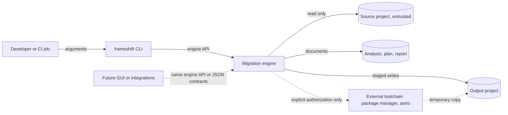
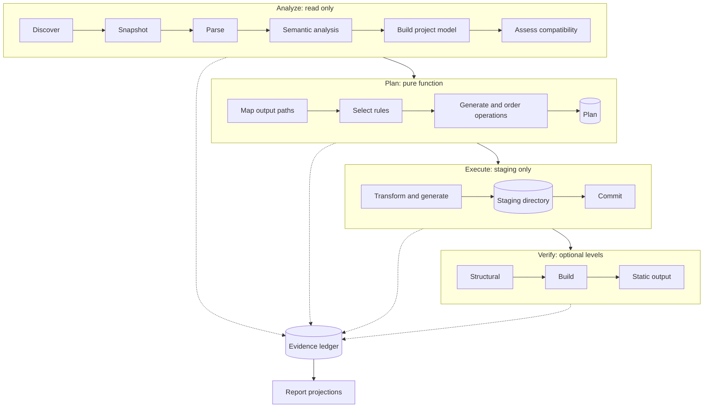
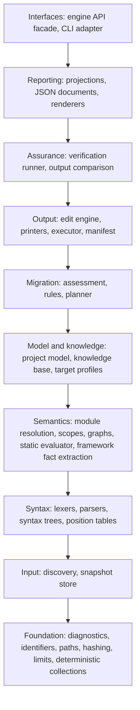
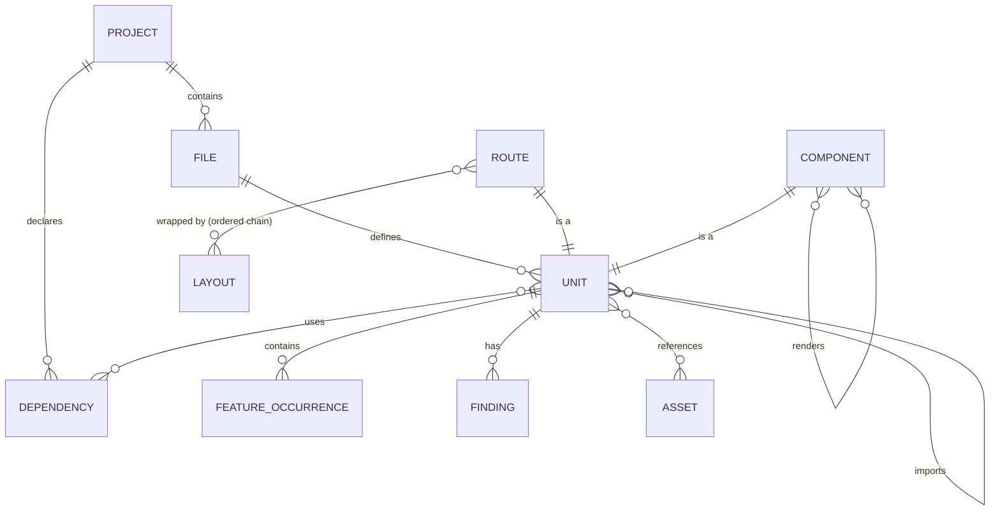

# Architecture

**Status: planned architecture with an initial M0 foundation.** Immutable source text, byte spans, derived positions, and pure span rewriting with text provenance are implemented. [IMPLEMENTATION.md](IMPLEMENTATION.md) records the existing modules and exact contracts. The pipeline and all remaining subsystems below are design intent. Identifiers such as `D-006` or `P-003` refer to entries in [DECISIONS.md](DECISIONS.md): "Accepted" entries are binding, "Proposed" entries are recommendations that still need confirmation.

Related documents:

- [ROADMAP.md](ROADMAP.md): scope, stages, milestones, and acceptance criteria.
- [MIGRATION_SPEC.md](MIGRATION_SPEC.md): the first migration path, Next.js to Astro + Preact.
- [MIGRATION_REPORTING.md](MIGRATION_REPORTING.md): status model, metrics, and report formats.
- [CLI.md](CLI.md): the planned command-line interface.
- [ENGINEERING.md](ENGINEERING.md): implementation language, dependency policy, and engineering practices.
- [SECURITY.md](SECURITY.md): threat model and safety controls.

## 1. Purpose

This document defines the conceptual architecture of the migration engine: the pipeline, subsystem boundaries, core data structures, rule engine, planning and execution model, verification, and reporting. Later implementation work must follow it or change it explicitly through a documented decision.

## 2. Architectural drivers

When these drivers conflict, the earlier one wins.

1. **Safety.** Source repositories are untrusted input. The engine never modifies them, never executes their code without explicit authorization, and never writes outside the designated output location.
2. **Correctness and honesty.** The engine never presents an incomplete, unverified, or unknown result as successful. Anything that is not handled by a rule is reported as unknown or unsupported ("fail closed", `D-009`).
3. **Determinism.** The same input snapshot, options, engine version, and ruleset version produce byte-identical plans, output files, and reports. The only exception is a clearly separated run-metadata section (timestamps, durations).
4. **Explainability.** Every classification, operation, and generated output region can be traced to a rule, a source location, and a documented reason.
5. **Maintainability.** KISS and YAGNI: the simplest structure that meets the current stage's requirements. No speculative abstraction.
6. **Performance.** Analysis of typical projects should feel instantaneous, and large repositories must stay tractable. External verification (installing packages, running builds) will dominate end-to-end time. The engine's own work must not.
7. **Extensibility.** New source frameworks, target frameworks, and rules must be addable without rewriting the core. Abstractions are introduced only when a second concrete use exists.

## 3. System context



- The CLI is a thin adapter. All migration logic lives in the engine (`D-005`).
- The engine does not access the network during inspection, analysis, planning, or migration (`D-006`).
- External tools run only for build-level verification, only with explicit authorization, and only on a temporary copy of the output (see [SECURITY.md](SECURITY.md)).

## 4. Pipeline

### 4.1 Evaluation of the initial pipeline

The initial proposal was:

Repository Discovery → Parsing → Static Analysis → Dependency Graph → Intermediate Representation → Compatibility Analysis → Migration Planning → Rule-Based Transformation → Target Generation → Verification → Reporting

The order is sound, but the proposal needs six refinements:

1. **Reporting is cross-cutting, not a final stage.** Every stage produces evidence: findings, decisions, operations, and verification results. These go into an append-only *evidence ledger*, and reports are projections of it. A failure in stage N still produces a meaningful report about stages 1 to N.
2. **A snapshot step is needed after discovery.** All later stages work on an immutable, content-hashed snapshot of the source files. This guarantees a consistent view even if files change during a run. It also gives plans and reports a verifiable input identity.
3. **"Dependency graph" means several graphs.** These are the package graph (manifest and lockfile), the module graph (imports and exports), the component graph (which component renders which), and the route tree. All of them belong to semantic analysis, not to a separate stage.
4. **Phases need hard side-effect boundaries.** Analysis is read-only, planning is a pure function, execution writes only to a staging area, and verification may run external tools only when authorized. These boundaries make dry-runs trivial, and they make the plan inspectable before anything is written.
5. **Transformation and target generation run together, per unit, before a separate commit.** Generated files go to a staging directory first. A commit step then moves the result into place atomically.
6. **Verification has levels and never feeds back automatically.** The engine does not loop "transform, build, adjust" until something compiles. Such loops hide problems and destroy determinism. Verification results are reported, and humans or later deterministic rules act on them.

### 4.2 Refined pipeline



| Phase | Input | Output | Side effects | Planned command |
| --- | --- | --- | --- | --- |
| Inspect | Source path | Project identity summary | Reads a bounded set of files | `frameshift inspect` |
| Analyze | Source path, target | Project model, assessment, findings | Reads source files | `frameshift analyze` |
| Plan | Analysis, target profile, ruleset | Plan with ordered operations | None | `frameshift plan` |
| Execute | Plan, output location | Output project, manifest | Writes to staging, then commits | `frameshift migrate` |
| Verify | Output project, optional source | Verification evidence | Structural: none. Build and static output: runs external tools on a temporary copy, only when authorized | `frameshift verify` |
| Report | Ledger or stored report | Human-readable or JSON reports | None | `frameshift report` |

## 5. Core concepts

| Term | Meaning |
| --- | --- |
| Source project | The project being migrated. Always treated as untrusted and read-only. |
| Output project | The newly generated project in a separate directory. |
| Snapshot | Immutable, content-addressed set of source files used for one run. Its hash identifies the input. |
| Unit | The smallest independently reported element of a migration, such as a route, layout, component, module, stylesheet, or configuration concern. Units do not overlap. The full taxonomy is in [MIGRATION_REPORTING.md](MIGRATION_REPORTING.md). |
| Inventory item | A counted but unweighted element: dependency, verbatim file, out-of-scope file, or ignored path. |
| Feature | A catalogued framework construct, such as `nextjs.link` or `react.hook.use-state`, identified by a stable feature ID. |
| Feature occurrence | One detected instance of a feature in a unit, with source location and extracted facts. |
| Finding | A diagnostic: code, severity, location, explanation, remediation, and the rule or check that produced it. |
| Assessment status | Pre-execution classification of a feature occurrence or unit: `auto`, `review`, `unsupported`, or `unknown`. |
| Rule | A versioned, tested transformation or assessment unit with declared preconditions, outputs, and verification requirements. |
| Ruleset | All rules, knowledge base data, and target profiles shipped with one engine version. |
| Operation | One planned output action: create, transform, copy, or preserve a file, or generate a configuration file. |
| Plan | The ordered, hashed list of operations and manual tasks, bound to a snapshot and ruleset. |
| Manifest | Provenance record written into the output project: versions, plan hash, output file hashes, and their origins. |
| Evidence ledger | Append-only record of findings, decisions, operations, and verification results for a run. |
| Target profile | Pinned target framework versions and conventions, for example `astro7-preact10`. |
| Knowledge base | Embedded, versioned data about framework APIs, package compatibility, and target capabilities. |

## 6. Subsystems and boundaries

The engine is layered. Dependencies point downward only. The CLI and future frontends sit on top and use the engine only through its public interface.



The vertical chain shows layer order, not single-step dependencies. A layer may use any layer below it.

Boundary rules:

- **Foundation** has no knowledge of frameworks. It provides diagnostics, stable identifiers, the internal path model (normalized, slash-separated, root-relative), hashing, resource limits, and collections with deterministic iteration.
- **Input** is the only layer that touches the source filesystem. Every later layer reads the snapshot.
- **Syntax** knows file formats but not frameworks.
- **Semantics** knows language semantics (modules, scopes) in general. Framework knowledge enters through *source adapters*, which extract framework facts.
- **Model and knowledge** hold data and contain no I/O.
- **Migration** computes. Planning is a pure function of the model, options, and ruleset.
- **Output** is the only layer that writes files, and only to staging and output locations given by the planner and executor.
- **Assurance** is the only layer allowed to start external processes, and only behind an explicit authorization flag.
- **Reporting** turns the ledger into documents. Terminal formatting belongs to the CLI, not to the engine.

## 7. Project discovery

Discovery determines what the project is before deep analysis starts.

1. **Root and boundaries.** The root is the directory the user passes. Discovery never leaves it. Symbolic links are not followed by default. A link that resolves outside the root is excluded and reported (`FS1003`). A link inside the root is recorded as a reference, so its target is not processed twice.
2. **Ignore policy.** Always ignored: version control directories (`.git/`), `node_modules/`, framework build outputs (`.next/`, and the static export directory when configured), and environment files (`.env`, `.env.*`, except example files meant for sharing), which are never even opened (see [SECURITY.md](SECURITY.md)). Patterns from the project's own `.gitignore` files are honored. The user's global Git configuration is never consulted, because that would make results depend on the machine. Every ignored path is counted and listed with its reason.
3. **Resource limits.** Per-file size, total file count, total bytes, and directory depth have deterministic limits. A file that exceeds a limit becomes an `unknown` unit with a finding. It is never silently skipped. Limits are size- and count-based, not time-based, so results do not depend on machine speed.
4. **Encoding.** UTF-8 is expected, and a UTF-8 byte order mark is recognized and preserved. Other text encodings make the file `unknown`. Binary files are identified by extension and content sniffing, and are treated as assets.
5. **Framework signatures.** A framework is identified by combined evidence: dependency declarations (`next` in `package.json`), configuration files (`next.config.js`, `.mjs`, `.ts`), directory conventions (`app/`, `src/app/`, `pages/`, `src/pages/`), and lockfile entries. A single signal is never sufficient on its own.
6. **Version detection.** Resolved versions come from the lockfile first. If there is no usable lockfile, the declared range in `package.json` gives a lower bound and the result is marked imprecise. Version-dependent rules then behave conservatively. `node_modules` is not read.
7. **Package manager.** The `packageManager` field in `package.json` takes precedence. Otherwise the lockfile type decides: `package-lock.json` (npm), `pnpm-lock.yaml` (pnpm), `yarn.lock` (Yarn classic or Berry, told apart by format), or `bun.lock` (Bun text lockfile). The binary `bun.lockb` format is detected but not parsed.
8. **Workspaces.** Workspace declarations (`workspaces` in `package.json`, `pnpm-workspace.yaml`) are detected. V1 migrates one package directory at a time. Sibling workspace packages are treated as external dependencies with unknown compatibility.

## 8. Parsing and syntax representation

### 8.1 Why structural parsing

Textual replacement (regular expressions, string search) is excluded for transformations. It cannot tell code from strings, comments, or JSX text. It cannot respect scopes: `Link` may be an aliased import, or a local variable that shadows one. And it cannot guarantee syntactically valid output. Every transformation in Frameshift operates on parsed structure.

### 8.2 Formats

| Format | Purpose | Notes |
| --- | --- | --- |
| JavaScript, TypeScript, JSX, TSX (`.js`, `.mjs`, `.cjs`, `.jsx`, `.ts`, `.mts`, `.cts`, `.tsx`) | Source code analysis and transformation | Full syntax coverage required. Types are parsed completely but treated mostly as opaque, preserved text. No type checking. |
| CSS, SCSS | Imports, `url()` references, CSS Modules class names, Tailwind directives | Tokenizer following the CSS Syntax specification, plus a structural parser. SCSS is supported at the level needed for imports and references. |
| JSON, JSONC | `package.json`, `tsconfig.json`, `jsconfig.json`, npm and Bun lockfiles | JSONC (comments, trailing commas) is required for TypeScript configuration and `bun.lock`. |
| YAML subset | `pnpm-lock.yaml`, `pnpm-workspace.yaml`, Yarn Berry lockfiles | A restricted parser for the subset these files use. Anything outside the subset is rejected with a finding. |
| Yarn classic lockfile | `yarn.lock` v1 | Dedicated format. |
| Astro templates | Re-parsing generated output for structural verification | Frontmatter is parsed as TypeScript. The template parser is scoped to what the printer generates and is refined in M7 (see [ROADMAP.md](ROADMAP.md)). |
| HTML | Static output comparison during verification | Build-versus-adopt decision pending (`Q-005`). |

The implementation strategy for these parsers (purpose-built or adopted) is covered in [ENGINEERING.md](ENGINEERING.md) and `P-002`.

### 8.3 Syntax tree requirements

- **Precise spans.** The M0 foundation already provides validated source spans and indexed positions (see [IMPLEMENTATION.md](IMPLEMENTATION.md)). Future syntax nodes record the byte offsets of their start and end in the original text. Line and column positions come from a per-file line table. Reports use byte offsets as the canonical location, with derived line and column for humans (columns count Unicode scalar values, `D-029`).
- **Comments and trivia.** Comments are kept with their spans in a per-file list. Attaching comments to nodes is a separate, deterministic step. Whitespace is not stored in the tree: the original text is always available, and unchanged regions are copied byte for byte.
- **AST, not CST, initially.** A span-precise abstract syntax tree combined with the original text supports edit-based rewriting (section 14) without a full concrete syntax tree. Experiment E2 tests this assumption. If it fails, a lossless concrete syntax tree is the fallback (`P-003`).
- **Error policy.** A file with syntax errors becomes `unknown` and is never transformed. The parser may recover far enough to report several errors in one pass. It never guesses a repair.
- **Resource safety.** Nesting depth and token counts are bounded, so hostile input cannot exhaust the stack or memory (see [SECURITY.md](SECURITY.md)).

## 9. Semantic analysis

Semantic analysis turns syntax trees into facts.

- **Module resolution.** Covers relative specifiers with extension and index resolution, the TypeScript `baseUrl` and `paths` settings from `tsconfig.json` or `jsconfig.json`, and package `imports` fields. Bare specifiers are mapped to dependencies by package name; package contents are never resolved. Asset and stylesheet imports are classified by extension. A dynamic `import()` with a literal specifier is resolved. A computed specifier is an `unknown` feature occurrence.
- **Scopes and bindings.** Declarations, imports, and shadowing are tracked, so that each reference resolves to its binding. This is how the engine knows that `<L href="/">` refers to `next/link` after `import L from 'next/link'`, and that a local variable named `Link` does not.
- **Graphs.**
  - *Package graph:* declared dependencies, resolved versions, and whether the code uses each one.
  - *Module graph:* imports and exports, including re-exports and barrel files.
  - *Component graph:* each JSX element resolved to its component definition where possible.
  - *Route tree:* segments, parameters, layout chains, and special route files.
- **Render contexts.** Next.js decides where code runs from `'use client'` boundaries: a module reachable through imports from a client boundary runs in the client context. Analysis computes the set of contexts (server, client, or both) for every component and module. This set decides the target strategy (see [MIGRATION_SPEC.md](MIGRATION_SPEC.md)).
- **Environment classification.** Code is classified as build-time only, browser only, or shared. This matters for environment variables, Node.js API usage, and browser API usage.
- **Static evaluator.** Configuration files (`next.config.*`, `tailwind.config.*`, `postcss.config.*`) and some declarations (metadata objects, `generateStaticParams` results) are evaluated by a partial evaluator over a safe subset. That subset covers literals, object and array literals, template literals with known parts, `const` bindings, and constant imports from local modules. Every other expression evaluates to `Unknown(reason)`. The evaluator never executes project code.
- **Framework fact extraction.** A source adapter (for V1, the Next.js adapter) extracts framework-specific facts. Examples are route segment configuration exports, metadata, directives, and calls to framework APIs.

## 10. Project model and intermediate representation

### 10.1 MVP: a project model, not a universal IR

V1 uses a project model that is just large enough for the Next.js to Astro + Preact path (`P-004`). It has two layers:

1. **Syntax layer:** per-file syntax trees with spans, comments, and original text. Function bodies, expressions, and types stay here.
2. **Semantic layer:** units and their relationships.



Model entities name concepts in framework-neutral terms where the concept is genuinely shared: route, layout, component, module, stylesheet, asset, configuration concern, dependency, render context, and hydration need. Information that only makes sense for one framework is stored in namespaced *facets*. For example, `nextjs.segmentConfig` stores `dynamic`, `revalidate`, and `dynamicParams`. Target-specific planning data never enters the source model.

### 10.2 Why not a universal IR first

- A universal IR designed before a second source or target exists would encode guesses about frameworks Frameshift does not support yet. YAGNI applies.
- Frameworks differ in execution model: React re-rendering, Astro build-time rendering, Svelte compile-time reactivity, Vue templates. No finite IR can represent all of them faithfully. A representation that pretends to would quietly lose information.
- The migration value is concentrated in architectural structure (routes, boundaries, rendering modes, assets, configuration). Arbitrary program semantics stay in syntax trees and are transformed by code-level rules.

### 10.3 Evolution in V2

In V2 the model is generalized into an intermediate representation with three parts:

- **Common core:** concepts that exist in at least two supported frameworks with compatible semantics, such as routes with parameters, layouts, components with props, static assets, stylesheets, and dependencies.
- **Facets:** framework-specific information attached to core entities and preserved without forcing it into the core.
- **Pair-specific recipes:** migration rules that need the facets of one source and one target. They coexist with generic recipes that rely only on the core.

A concept moves into the core only when two adapters need it with compatible meaning. The V2 refactoring is proven by unchanged golden outputs for all V1 fixtures (see [ROADMAP.md](ROADMAP.md)).

## 11. Compatibility assessment

1. **Feature catalog.** Every supported or recognized construct has a stable feature ID. The catalog for V1 is the compatibility matrix in [MIGRATION_SPEC.md](MIGRATION_SPEC.md).
2. **Detection.** Detectors produce feature occurrences from model facts. Constructs that analysis cannot match to the catalog become occurrences of a generic `unknown` feature with their location.
3. **Assessment rules.** Each occurrence receives `auto`, `review`, `unsupported`, or `unknown`, with a reason. The status may depend on context: source version, render context, target profile, or knowledge base data.
4. **Unit status.** A unit's status is the most severe status among its occurrences, ordered `auto` < `review` < `unknown` < `unsupported`. All occurrences remain listed.
5. **Transitive readiness.** Unit status is local. Route readiness looks at the route's transitive dependency closure: layouts, rendered components, imported modules, and stylesheets. This gives route-level answers such as "this route is blocked by a context provider shared across islands" (see [MIGRATION_REPORTING.md](MIGRATION_REPORTING.md)).
6. **Dependencies.** The knowledge base assigns each declared package a compatibility class for specific version ranges. For the first migration path, the classes are `framework`, `compatible`, `compat` (works through `preact/compat`), `compat-unverified`, `incompatible`, and `unknown` (see section 14 of [MIGRATION_SPEC.md](MIGRATION_SPEC.md)). Code that uses an incompatible package gets an occurrence of `dependency.incompatible`. An unused declared package affects nothing except the dependency inventory.
7. **Project-level verdicts.** Some answers concern the whole project, such as "can the result be built as a static site". These verdicts are derived from explicit facts (for example, "request-time APIs are used on 9 of 12 routes"), not from percentage thresholds.

### 11.1 Knowledge base

The knowledge base is data embedded in the binary and versioned with each release. It contains:

- the framework API catalog, such as Next.js APIs, the versions that introduced or removed them, and their migration strategy;
- package compatibility entries, each with a version range, status, notes, and the fixture IDs that provide evidence;
- the `preact/compat` coverage table for the pinned Preact version;
- target profiles: pinned versions of Astro, `@astrojs/preact`, and Preact, plus required Node.js versions and conventions.

Every entry records the evidence and the version it was last verified against. Changes go through pull requests with tests, like code. The knowledge base version appears in every plan and report.

## 12. Rule engine

### 12.1 Rule anatomy

A rule is code plus declarative metadata. Illustrative pseudocode, not a committed syntax:

```text
rule nextjs-to-astro-preact/route.static-page
  version: 3
  source: nextjs >= 14.0 < 17, router = app
  target: profile astro7-preact10
  matches: feature nextjs.app.page
  requires:
    - unit.kind == route
    - every route segment is static
    - the page component is convertible to an Astro component
  produces:
    - create src/pages/<route path>.astro from the page component
  excludes: route.dynamic-static-params, route.catch-all
  verifies:
    - structural: output re-parses, imports resolve, no residual next/* imports
    - static-output: route compared with the source build
  documentation: explanation, examples, fixtures
```

### 12.2 Lifecycle

| Aspect | Design |
| --- | --- |
| Registration | Rules are registered at compile time in a registry per migration path. IDs are unique. Metadata is validated by tests. There is no runtime loading in V1 or V2 (plugins are deferred, `DF-002`). |
| Matching | A feature ID index finds candidate rules. Preconditions are predicates over model facts and are evaluated without side effects. |
| Prioritization | V1 has no numeric priorities. For any feature occurrence, at most one transformation rule may match: preconditions must be mutually exclusive. Tests check this, and the planner checks it again. Ambiguity produces finding `FS4001`, and the occurrence becomes `unknown` (fail closed). V2 introduces explicit composition and priorities when declarative recipes require them. |
| Validation | Preconditions are checked before planning. Postconditions are checked after emission: output parses, references resolve, residue checks pass. A postcondition failure marks the unit `failed`. |
| Composition | Operations from different rules must target disjoint output files, or disjoint spans within one file. Overlapping edits are detected at plan time and handled like ambiguity. |
| Execution | Rules never write files. They return operations, and the executor applies them. |
| Auditing | Each operation records the rule ID and version, the source spans it consumed, and the output regions it produced. These records form the provenance in the manifest. |
| Testing | Each rule has positive fixtures, negative fixtures (preconditions not met), and golden outputs. Rule documentation is the source for `frameshift explain`. |
| Versioning | A rule's version increases whenever its output can change. The ruleset version combines the engine release, knowledge base version, and target profile. Plans record all of them. |

### 12.3 Rule identifiers

A full rule ID is `<migration-path-id>/<area>.<name>`, for example `nextjs-to-astro-preact/route.static-page`. Reports for a single migration path may show the short form `route.static-page`. Finding codes and the full naming scheme are defined in [ENGINEERING.md](ENGINEERING.md) and [MIGRATION_REPORTING.md](MIGRATION_REPORTING.md).

## 13. Migration planning

The planner knows everything it intends to do before any file is written.

1. **Path mapping (pass 1).** Every unit and copied file receives its output path. This is a global step, because import rewriting needs the final location of every module. Path collisions, including collisions on case-insensitive filesystems, are detected here.
2. **Operation generation (pass 2).** The selected rule for each unit produces operations. Units classified `unsupported` or `unknown` produce *preserve* operations and manual tasks instead.
3. **Ordering.** Operations are sorted by output path, then operation ID. They write distinct files, so they can run in parallel without affecting the result.
4. **Binding.** The plan records the snapshot hash, engine version, ruleset version, target profile, and every option that affects output. The plan hash covers all of them.
5. **Plan file as an approval artifact.** `frameshift plan --out plan.json` writes the plan for inspection. `frameshift migrate --plan plan.json` does not execute the file's contents. It recomputes the plan from the source and refuses to continue if the hashes differ (`P-005`). Tampered or stale plan files therefore cannot inject operations, and the approved plan is exactly what runs.

Operation kinds:

| Kind | Meaning |
| --- | --- |
| `create` | Generate a new file, such as an `.astro` component, from model data and source slices. |
| `transform` | Apply span edits to a source file and write the result to its output path. |
| `copy` | Copy a file verbatim. |
| `preserve` | Copy an unmigrated source file into `.frameshift/unmigrated/` for manual work. |
| `config` | Generate a structured configuration file (`package.json`, `astro.config.mjs`, `tsconfig.json`). |

Manual tasks are part of the plan but are not operations. Examples: "rename environment variables in your hosting provider" and "port the server action in `app/contact/actions.ts`".

## 14. Transformation and code generation

### 14.1 Two levels

- **Structural transformations** are driven by the project model: file layout, routes, layout chains, configuration, and dependencies.
- **Code-level transformations** are driven by syntax trees: JSX conversion, import rewriting, API replacement, and directive removal.

### 14.2 Edit engine

The M0 edit core implements span edits against immutable original text: replace, insert, or delete a byte range. Edits must not overlap. Insertions at the same offset use operation order, then edit order; each ordering pair is unique. Insertions at a replacement boundary precede a replacement starting there and follow one ending there. Insertions inside a replacement are conflicts. Invalid edits return errors without partial output. Text outside edited spans is copied byte for byte. The core also records text-region provenance and deleted spans. Exact contracts and limits are in [IMPLEMENTATION.md](IMPLEMENTATION.md). Parser-driven edits, printers, and rule/file provenance remain planned; E2 must still validate the AST approach (`P-003`).

### 14.3 Printers

New files are produced by printers, for Astro components, JSON, and JavaScript configuration modules. Printers build generated structure canonically and embed slices of original source text for expressions, statements, and types where possible. When a page component becomes an `.astro` file:

- Its body statements go to the frontmatter as source slices, with span edits applied.
- Its JSX becomes the template. The printer walks the JSX tree, prints markup canonically, and copies expression containers as source slices.

Printer rules:

- **Escaping.** Every string that comes from the source and is embedded in a new syntactic context (HTML text, attributes, JavaScript string literals, template expressions) is escaped for that context. Source content can never inject markup or code into generated files (see [SECURITY.md](SECURITY.md)).
- **Imports.** Imports are added, removed, and rewritten with deduplication. Retained imports keep their order. Generated imports follow them in a deterministic order.
- **Identifiers.** Generated identifiers are checked against the bindings in scope. Collisions are resolved by deterministic suffixing.
- **Formatting.** Generated code uses the project's dominant indentation style, detected from the snapshot, and falls back to two spaces. External formatters are not run, because that would require executing third-party tools.
- **Comments.** Comments in copied regions are preserved. Leading comments of a removed construct stay at the removal position.
- **Line endings and encoding.** Transformed files keep their original line endings and byte order mark. New files use the project's dominant line ending, also detected from the snapshot. Operating system defaults are never used.

### 14.4 Output layout and generated support files

- **Layout.** The output follows the conventional target structure, for Astro with all code under `src/`. Data read at build time stays where its filesystem paths expect it (`D-024`). Details are in [MIGRATION_SPEC.md](MIGRATION_SPEC.md).
- **Compatibility helpers.** When a rule needs runtime support code (for example, a small navigation shim), the code is generated into `src/frameshift-compat/`. Each helper is listed in the report with its purpose and removal guidance.
- **Unmigrated sources.** Files that cannot be migrated are copied into `.frameshift/unmigrated/` under their original relative paths. Nothing is dropped silently. Every source file is transformed, copied, preserved, or reported as out of scope or ignored.
- **Manifest and report.** `.frameshift/manifest.json` and `.frameshift/report.json` record provenance and results. `.frameshift/SUMMARY.md` summarizes remaining manual tasks for humans, and the CLI points to it after every migration (`P-011`).

## 15. Safe execution

| Requirement | Design |
| --- | --- |
| Dry-run | `migrate --dry-run` runs everything except the commit. It shows the files it would write and the summary, and writes nothing unless a report file is requested. |
| Non-destructive output | The output location must not exist, or must be empty, unless an explicit overwrite policy applies. It must not be inside the source directory, the source must not be inside it, and it must not be a filesystem root or the user's home directory. |
| Staging and atomic commit | All files are written to a staging directory next to the output location, on the same filesystem. On success, the staging directory is renamed to the output path, which is atomic when the target does not exist. |
| Overwrite policies | Default: fail if the output exists. `replace-managed` replaces an existing output only if its manifest identifies it as Frameshift output and every file still matches the manifest hashes, so no manual edits can be lost. The previous output is moved aside, never deleted. Arbitrary directories are never deleted. |
| Recovery from partial failures | A crash leaves the source untouched, the output absent or unchanged, and a marked staging directory. The next run refuses to proceed until that staging directory is cleaned up. Cleanup removes only directories that carry the Frameshift staging marker. |
| Unit-level failures | A failing operation marks its unit `failed`, and the failure is recorded. Other units continue, and the output is committed with the failures reported. In `--strict` mode, any failure aborts the run before commit. |
| Idempotency | Re-running with the same inputs produces a byte-identical output tree. If the existing managed output is already identical, the commit is skipped. |
| Determinism | No timestamps, random values, absolute paths, or machine-specific data in output files, plans, or manifests. |
| Isolation | Temporary files live inside the staging directory. The executor accepts only validated relative output paths, so a path can never resolve outside the output location (see [SECURITY.md](SECURITY.md)). |

## 16. Verification

Verification produces evidence, never proof. Levels are cumulative:

| Level | Checks | Requires | Demonstrates | Does not demonstrate |
| --- | --- | --- | --- | --- |
| `structural` | Generated files re-parse. Imports resolve within the output. No residual source-framework APIs (such as `next/*` imports or `'use client'` directives) remain unless flagged. Every source route maps to an output route or a finding. Manifest hashes match. | Nothing external | The output is syntactically valid and internally consistent | That it builds, runs, or behaves the same |
| `build` | Install dependencies and run the target's type check and production build | `--allow-exec`; network access for installation | The output compiles with the pinned toolchain | Behavioral equivalence |
| `static-output` | Build source and output and compare the generated HTML per route: route set, normalized text content, links, headings, landmarks, metadata, image references | `--allow-exec`; a statically exportable source | That build-time rendered content matches on the compared dimensions | Runtime interactivity, visual layout, CSS cascade, timing |
| `runtime` (V2 or later) | Headless browser checks of hydration, interactions, and accessibility trees | External browser; explicit authorization | Selected runtime behaviors | Full behavioral equivalence |

Rules declare which levels can verify their outputs. Evidence is recorded per unit: a unit counts as verified at a level only if every check covering it ran and passed. The external tool runner works on a temporary copy of the output with a scrubbed environment, enforces timeouts, limits captured output, and treats tool output as untrusted data (see [SECURITY.md](SECURITY.md) and [TESTING.md](TESTING.md)).

## 17. Reporting

The evidence ledger holds four entry types: findings, decisions (which rule was chosen, or why none matched), operations, and verification results. Reports are deterministic projections of the ledger. Supported projections: project summary, per-file, per-unit, per-route, dependencies, configuration changes, rules applied, findings, verification, and manual tasks. Machine-readable documents are versioned JSON. Human-readable rendering happens in the CLI. Metrics are defined precisely in [MIGRATION_REPORTING.md](MIGRATION_REPORTING.md).

## 18. Interfaces

- **Engine API.** A small in-process interface: `inspect`, `analyze`, `plan`, `execute`, `verify`, and `render`. Each takes explicit options and returns structured results. The engine never reads global state, environment variables, or terminal properties. Cancellation is cooperative.
- **Documents.** Analysis, plan, report, and manifest are versioned JSON documents (`kind` plus `schemaVersion`). They form the stable contract for tools and future frontends.
- **Progress events.** The engine emits structured progress events (phase started, file parsed, operation emitted). The CLI renders them to the terminal. A planned NDJSON event stream exposes them to other programs.
- **CLI.** Parses arguments, calls the engine, renders results, and maps outcomes to exit codes. It contains no migration logic.
- **Future frontends.** A GUI or editor integration can link the engine as a library, or call the CLI with JSON output and the event stream. Either way it uses the same engine, so there is no second migration implementation (`D-005`). No frontend is in scope today (`D-004`).

## 19. Extensibility

- **Source adapters** provide discovery signatures, framework fact extraction, the feature catalog entries, and source-side assessment.
- **Target adapters** provide target profiles, path conventions, printers for target-specific file types, configuration generation, and target-specific verification steps.
- **Rule packs** belong to a migration path and use the model's neutral concepts where possible and facets where necessary.
- **Knowledge base updates** extend coverage without code changes when a new package or API fits existing strategies.
- **Plugins** are deferred (`DF-002`). Options to evaluate in V2: compile-time only (status quo), an out-of-process protocol, or WebAssembly modules. A plugin mechanism will be introduced only if third-party rule development becomes a real need, because it adds security and compatibility surface.
- **Optional model assistance** connects at exactly one seam: after deterministic planning, for occurrences already classified `unknown` or `review`. A model may only choose among deterministic strategies that are already implemented, or route an occurrence to human review. It never edits output directly (see [LLM_POLICY.md](LLM_POLICY.md)).

## 20. Concurrency, determinism, and performance

- **Parallelism.** Per-file stages (reading, parsing, per-file fact extraction) and per-operation emission run in parallel. Global steps (graph construction, path mapping, assessment propagation) run after these per-file stages finish.
- **Deterministic merge.** File IDs are assigned from the sorted list of normalized paths before parallel work starts. Parallel results are stored by ID, never by completion order.
- **No order dependence.** No output may depend on hash map iteration order, filesystem enumeration order, scheduling, locale, wall-clock time, or random values. Collections that are serialized or iterated for output are sorted by a total order.
- **Integer metrics.** Percentages are computed from integer numerators and denominators with a specified truncation rule. No floating point is involved, so results are identical across platforms (see [MIGRATION_REPORTING.md](MIGRATION_REPORTING.md)).
- **Memory.** Compact node representations, string interning for identifiers and paths, and per-file allocation patterns that free memory in bulk. Performance budgets are in [ENGINEERING.md](ENGINEERING.md).

## 21. Architecture review: key questions

1. **Is a universal IR justified for the MVP?** No. V1 uses a project model sized for one migration path, with neutral naming and framework facets. The IR is extracted in V2 once a second source or target exists (section 10).
2. **How do rules stay deterministic across different execution models?** Rules are pure functions of model facts, options, and versioned data. Each one encodes an explicit, documented semantic mapping with preconditions. Where the engine cannot statically prove a precondition, the rule classifies the occurrence as `review` or `unsupported`, and does so deterministically. Determinism guarantees reproducibility, not correctness. Correctness comes from preconditions, postconditions, and verification.
3. **What must be preserved for auditability?** Snapshot hash, file content hashes, byte spans of consumed source, the rule ID and version for each operation, the provenance of every output region, versions of the engine, ruleset, knowledge base, and target profile, the options that affect output, and the reason for every classification (sections 12, 13, and 14).
4. **How is coverage measured without misleading percentages?** Assessment, execution, and verification are separate status dimensions. Every percentage has an explicit numerator and denominator. Unknown is always shown. Fixed, documented weights are used, and bulk verbatim files are excluded from headline figures. Values are truncated, never rounded up (see [MIGRATION_REPORTING.md](MIGRATION_REPORTING.md)).
5. **How do dependency incompatibilities influence the plan?** Through usage, not declaration. Code that uses an incompatible package is classified accordingly, and route readiness reflects this transitively. Retained packages keep their resolved versions. Incompatible packages are reported with alternatives where the knowledge base knows any (section 11).
6. **How are silent regressions prevented?** Fail-closed classification, rule postconditions, residue scans, route parity checks, golden and regression tests in Frameshift's own CI, verification levels with explicit scope, and reports that never claim more than the checks that ran (sections 11, 12, and 16).
7. **What is the smallest useful capability?** An accurate analysis-only report for a Next.js App Router project, which tells users how migratable their project is and why. After that comes the migration of static routes, layouts, links, global styles, and public assets, verified structurally and by build (see [ROADMAP.md](ROADMAP.md)).
8. **How do we avoid third-party libraries without unmaintainable code?** Build only bounded, well-specified components: parsers for documented formats, a specified semver grammar, gitignore matching. Write the specification first, test against public conformance suites, fuzz, and document limitations. Never build a type checker, bundler, or network package resolver (see [ENGINEERING.md](ENGINEERING.md)).
9. **Which language?** Rust is the primary language for all stages (`D-018`). Other languages may be used for specific, important tasks behind clear boundaries when they offer a demonstrable quality advantage (`D-019`). Full reasoning is in [ENGINEERING.md](ENGINEERING.md).
10. **How are new framework adapters added without rewriting the core?** The layering of section 6 places framework knowledge only in adapters, rule packs, and knowledge base data. The core works on neutral concepts and opaque facets. V2 proves this by adding a second source and a second target without core changes that are specific to a migration path.
11. **Where would optional model assistance connect?** At a single post-planning seam, limited to choosing among implemented deterministic strategies or routing to review (section 19, [LLM_POLICY.md](LLM_POLICY.md)).
12. **How does Frameshift stay CLI-first but reusable?** The engine API and versioned JSON documents are the contract. The CLI is one adapter with no migration logic (section 18).
13. **What is undecidable or unverifiable?** See section 22.
14. **How is an optimized target distinguished from a behavior-preserving conversion?** Every operation is either a *conversion* (intended to preserve behavior) or an *optimization* (intended to improve the result while changing observable characteristics, such as hydration timing or image formats). Conversions are the default. Optimizations are opt-in, reported in a separate category, and never counted as plain migration. Example: `client:load` preserves Next.js hydration timing, while `client:visible` is an optimization (`P-009`).

## 22. Limits of automated migration

These limits are fundamental, not temporary gaps:

- **Behavioral equivalence is undecidable in general.** By Rice's theorem, no algorithm can decide whether two arbitrary programs behave identically. Frameshift can only apply mappings that are correct under stated preconditions, and collect evidence through tests and comparisons.
- **Dynamic code defeats static analysis.** Computed import specifiers, `eval`, dynamically built class names (for example `` `bg-${color}-500` ``), reflection over props, and data-dependent rendering cannot be fully analyzed statically. They are reported as `unknown`.
- **Runtime environment differences.** Request-time data, cookies, and headers have no equivalent in static output. Build-time data fetched from external services can change between builds of source and output, so comparisons can show differences that have nothing to do with the migration.
- **Third-party behavior.** The internal behavior of dependencies is outside the analyzed code. Compatibility claims about packages are evidence-based approximations.
- **Visual and interaction equivalence.** CSS cascade order, layout, animation timing, focus management, and hydration timing can differ even when markup matches. Static output comparison does not cover them. Runtime verification can cover some of them, never all.
- **Intent.** Code does not record why it was written. Whether a `'use client'` directive is necessary, or a loading state matters, often depends on intent only humans know. Such cases are `review` items.

## 23. Open architectural questions

Open questions are tracked in [DECISIONS.md](DECISIONS.md), notably weight values (`Q-002`), static output comparison thresholds and HTML parsing (`Q-005`), and parser error recovery depth (`Q-011`).
