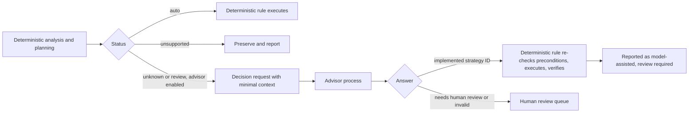

# LLM and AI Policy

**Status: policy and future research direction.** Frameshift contains no AI functionality, and none is planned for V1 or V2. This document explains why the engine is deterministic-first, sets the rules any future model-assisted capability must follow, and evaluates decision-oriented models as a possible future tool. Optional model assistance appears only as a V3 research track (T10 in [ROADMAP.md](ROADMAP.md)).

This policy concerns product features. AI agents that help develop the repository are governed by [AGENTS.md](../AGENTS.md), not by this document.

## 1. Position

1. **The deterministic engine is the source of truth** (`D-006`). Every classification, plan, and transformation in normal operation comes from versioned, tested rules.
2. **Normal operation never depends on a model.** Frameshift works completely offline, without any AI provider, account, or network connection.
3. **AI is never the foundation.** If model assistance is ever added, it is an optional, narrowly scoped helper that sits outside the core and can be removed without affecting deterministic results.

## 2. Why deterministic-first

| Requirement | Why models conflict with it |
| --- | --- |
| Determinism and reproducibility | Model outputs vary across versions, providers, and sometimes runs. Frameshift promises byte-identical results for identical inputs. |
| Explainability | A rule can cite its precondition and documentation. A model's answer cannot be traced to a verifiable reason. |
| Honesty | Models can be confidently wrong. Frameshift must never present a guess as a verified result. |
| Privacy | Source code is often private. Sending it to a provider is a disclosure. |
| Offline operation | Many users work in restricted environments. Frameshift must run without network access. |
| Security | Source repositories are untrusted. Content such as comments or strings can manipulate a model's decision (prompt injection). |
| Cost and availability | External services cost money, change, and fail. Core functionality cannot depend on them. |

## 3. Generative and decision-oriented models

| Aspect | Generative models | Decision-oriented models |
| --- | --- | --- |
| Output | Free text or code, possibly shaped as JSON | A choice from options the application defines, a rubric score, or a probability that a statement is true |
| Output space | Open. The model can produce anything. | Bounded by the application. The answer is always one of the declared options. |
| Fit for synthesizing migrated code | Possible in principle, but output must be verified like untrusted code | None. These models do not produce code. |
| Fit for routing and classification | Possible, but unbounded output must be parsed and constrained | Good fit by design |
| Main risks | Plausible but wrong code, hidden behavior changes, prompt injection | Wrong choice among valid options, prompt injection, over-trust in probabilities |

A typed decision model cannot synthesize migrated code. At most, it can select among transformations that already exist, or decide that a case needs a human.

## 4. Evaluation of Jev

**Facts as of October 2026**, from TypeSafe AI's announcements and third-party coverage:

- Jev is a "decision model" by TypeSafe AI, announced in early access in September 2026.
- The application supplies state (text, JSON objects, or arrays) and one or more questions. Each question has a bounded set of allowed answers.
- Jev returns typed answers with probabilities: a choice among options, a rubric score, or a boolean probability. It evaluates independent questions together.
- It does not generate prose or code. The vendor itself notes that outputs conforming to the schema are not guaranteed to be correct, and that decisions need evaluation against known outcomes.
- It is available as a hosted model, for example through Vercel's AI Gateway. No local or offline deployment was documented in the sources reviewed.
- An independent security study by Check Point found that adaptive attackers who controlled part of the input document could change Jev's verdict in every configuration tested. Typed, structured input and "untrusted" labels gave no meaningful protection. The authors recommend not treating output formats as security boundaries, and not exposing decision models to untrusted input without additional safeguards.

**Assessment for Frameshift:**

| Question | Assessment |
| --- | --- |
| Does the interaction model fit? | Yes, conceptually. "Choose one of these implemented strategies, or route to human review" is exactly a bounded decision. |
| Could it synthesize migrated code? | No. It returns decisions, not code. |
| Does it meet the offline requirement? | Not as documented. A hosted-only model can only be an opt-in, online, optional feature. |
| Does it meet the privacy requirement? | Only with minimal, redacted context and explicit user consent for each run. |
| Is it robust against hostile source code? | Evidence says no. Source repositories are untrusted, so any decision a model makes must be limited to options that are all safe, and must be validated deterministically. |
| Do its probabilities indicate correctness? | No. A probability expresses the model's preference, not correctness. Frameshift must never treat it as proof. |

**Conclusion:** decision-oriented models such as Jev are a plausible future tool for narrow routing decisions, under the constraints in sections 5 and 8. Nothing about them justifies a dependency in V1 or V2. Any adoption requires the evaluation in section 9, and an accepted decision record.

## 5. Possible future architecture

### 5.1 The single seam

Model assistance may connect at exactly one point: after deterministic planning, and only for feature occurrences the engine has already classified as `unknown` or `review`. It never touches occurrences classified `auto` or `unsupported`, and it never modifies output directly.

### 5.2 Decision requests

A decision request has three parts:

- **A structured question**, for example "Which strategy applies to this component?" or "Does this construct match transformation category X?".
- **Allowed answers:** the IDs of deterministic strategies that Frameshift already implements and that are valid for this occurrence, plus "needs human review". Every allowed answer must be safe to choose, because the model may choose wrongly.
- **Minimal context** (section 5.3).

Candidate questions, matching the use cases under consideration:

| Use case | Suitability |
| --- | --- |
| Classifying an unfamiliar code construct into a known category | Suitable. The result routes the occurrence to an existing rule, whose preconditions are re-checked. |
| Selecting between known migration strategies | Suitable, if every candidate strategy is implemented, and its preconditions are verified before execution |
| Determining whether a snippet matches a transformation category | Suitable as a hint. The category's rule decides deterministically whether its preconditions hold. |
| Identifying when human review is required | Suitable only in one direction: a model may *add* a review requirement, never remove one |
| Routing unsupported cases to the right processing strategy | Suitable for routing to documentation, manual task templates, or future rules. Never to automatic execution of something unsupported. |

### 5.3 Minimal context

- The context is the smallest semantically meaningful slice of code: the construct itself, plus the signatures (not the bodies) of the declarations it references, plus the facts the engine already knows (render context, versions, the relevant knowledge base entries).
- There is a hard size limit per request.
- Whole files are never sent unless the construct is the whole file and within the size limit. Whole repositories are never sent.
- Secrets are redacted before sending: string literals that look like credentials, high-entropy strings, URLs with credentials, and every value from environment-related code. Identifiers may be replaced with neutral placeholders when they are not needed for the decision.
- The exact payload is reproducible and can be shown to the user without sending it (a dry-run of the advisor).

### 5.4 Advisor as an external process

- The core binary contains no AI client and no network code. An advisor is a separate program that speaks a documented, versioned protocol (structured requests and responses over standard input and output).
- This keeps the core offline-capable and free of dependencies, and lets users choose a local model, a hosted model, or no advisor.
- An advisor runs only when the user enables it explicitly for a run (for example with an option naming the advisor), never through a persistent default.

### 5.5 Validation and execution

- An answer outside the allowed set is treated as "needs human review".
- A chosen strategy executes only through its deterministic rule. That rule re-checks every precondition it can check. If a precondition fails, the occurrence goes to human review.
- Outputs go through the same postconditions and verification as any other output.
- A model answer never overrides a deterministic classification. It is only consulted for occurrences the engine could not classify on its own.

### 5.6 Reporting and audit

- Model-assisted results form a separate category in every report. They are never counted as `auto`, and always require human review.
- Audit records contain the request hash, advisor and model identifiers and versions, the allowed answers, the chosen answer, and the reported probability, if any. Timestamps go into the report's `run` section.
- The deterministic part of a run stays reproducible. A rerun with the advisor disabled produces exactly the deterministic results.

## 6. Generative code models (V3 research only)

If generative models are ever explored for synthesizing transformations:

- Outputs are proposals, never results. They must parse, satisfy every applicable rule postcondition, and pass verification at the strongest available level.
- They are labeled "model-proposed" in every report and require human review.
- They never replace a deterministic rule that already handles the case.
- A useful long-term role is to help *develop* deterministic rules offline (for example, suggesting a candidate rule that humans then implement, test, and review), rather than transforming user code at run time.

## 7. Privacy and security requirements

Any model-assisted feature must:

1. Be explicitly opt-in for each run.
2. Operate on minimal relevant context (section 5.3).
3. Never transmit entire repositories.
4. Protect secrets and private information through redaction and the existing rules in [SECURITY.md](SECURITY.md).
5. Use structured inputs and outputs only.
6. Preserve an auditable link to the original code (unit, location, request hash).
7. Never silently override verified deterministic rules.
8. Validate every proposed decision or transformation deterministically.
9. Require manual review for every model-assisted result.
10. Never treat model confidence or probability as proof of correctness.
11. Treat source content as hostile input to the model, and limit every model decision to options that are safe even if the model is manipulated.
12. Allow fully local operation where a suitable local model exists. Prefer local models.
13. Document the data handling of any supported hosted provider, including retention.

## 8. Defenses against prompt injection

- Every option a model can choose must be safe to execute, so a manipulated decision can at worst pick a suboptimal implemented strategy that deterministic checks still guard.
- A model can never disable verification, remove review requirements, or widen access (filesystem, network, process execution).
- Comments and string literals can be stripped or neutralized in the context when they are not needed for the decision.
- Evaluation includes adversarial fixtures that try to manipulate decisions through comments, strings, and identifiers (section 9).

## 9. Evaluation before adoption

A model-assisted capability can be accepted only if an offline evaluation on a labeled corpus shows all of the following:

- **Zero false `auto` added.** Model assistance never causes an incorrect automatic migration in the evaluation, because its results are never automatic in the first place.
- **Measurable reduction of review burden:** model-routed occurrences that a human reviewer confirms, compared with sending every case directly to review.
- **Robustness:** adversarial fixtures with injected instructions do not lead to unsafe outcomes. Allowed answers are safe by construction, so this checks that the constraints actually hold.
- **Privacy:** recorded payloads stay within the minimal context rules.
- **Acceptable cost and latency** for the users who opt in.

The results are recorded in [DECISIONS.md](DECISIONS.md) together with the decision.

## 10. Non-goals

- Any dependency on an AI provider for normal operation.
- Model-generated code presented as a migration result.
- Uploading repositories or large code excerpts.
- Using model probabilities as quality metrics in migration reports.
- Replacing deterministic rules with model decisions.
