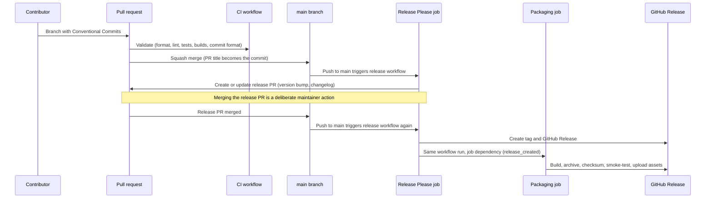

# Releases and CI/CD

**Status: CI and gated release foundation implemented (`D-051`, `D-052`).** Workflows, release configuration, and a release manifest exist. No release has been published. Release PR tooling is implemented and temporarily paused for the environment-secret transition; M1 was accepted on 2026-10-19 (`D-063`), and publication stays disabled until the owner sets `FRAMESHIFT_M1_RELEASE_READY=true`. Section 13 of [IMPLEMENTATION.md](IMPLEMENTATION.md) records actual local and remote evidence. The remaining signing, immutable release, binary reproducibility, scheduled verification, and product smoke-test requirements below are plans for later milestones.

### Current controls and commands

- `.github/workflows/ci.yml`: pull requests, pushes to main, and manual runs. Native tests on all six platforms, default and portable SHA-256 backend contracts, formatting, Clippy, commit conventions, Cargo boundaries, corpus and E2 checks, cross-platform E2 hash comparison, and read-only packaging validation. `CI required` is the aggregate branch-protection check.
- `.github/workflows/release.yml`: push to main or manual run on main only. `FRAMESHIFT_RELEASE_APP_READY=true` enables release PRs. It is temporarily false; the environment-aware workflow reached main on 2026-10-19 (`f7f5870`), and the owner re-enables the variable and verifies a Release run (`D-066`). `FRAMESHIFT_RELEASE_APP_ID` identifies the private App, and `FRAMESHIFT_RELEASE_APP_PRIVATE_KEY` is stored only as a secret of the `release` environment, which admits only `main`. The repository secret has been deleted (section 13 of [IMPLEMENTATION.md](IMPLEMENTATION.md)). Tokens are short-lived and restricted to `eiserv/frameshift`.
- `FRAMESHIFT_M1_RELEASE_READY=false`: Release Please skips tags and releases. Packaging cannot upload release assets until this repository variable is deliberately set to `true` after M1 acceptance, which follows the criteria and the explicit owner confirmation of `D-063`. No workflow merges release PRs.
- `.github/workflows/package.yml`: a read-only reusable six-target build and archive validation, also manually dispatchable with an existing tag or commit. Its `publish` input validates release eligibility but cannot upload assets itself. Actual uploads occur only in the gated Release workflow, after packaging succeeds. Failed release uploads are retried by rerunning the Release workflow's failed jobs.
- `.github/scripts/check.ps1`: local Cargo boundaries, the reviewed external dependency graph (`.github/dependencies.json`), workspace version consistency, exact Release Please lockfile selectors, and Action pins. `pwsh -NoProfile -File .github/scripts/test-check.ps1` runs positive and negative policy regressions using in-memory metadata copies. With `-Conventions`, uses a GitHub event file to check PR titles and commit subjects. Native shell subjects are data, never executed.
- `tools/frameshift-release`: Go 1.25.5 standard-library-only archiver and checksum writer (`D-052`). `go -C tools/frameshift-release run . pack --binary <binary> --docs <repository> --out <existing directory> --version <version> --os <linux|macos|windows> --arch <x86_64|arm64> --epoch <commit Unix time>`, then `go -C tools/frameshift-release run . checksums <artifact directory> <version>`. Paths are relative to the Go module when using `go -C`.
- `FRAMESHIFT_BUILD_COMMIT`: optional build input, validated as a complete lowercase Git SHA-1 and embedded in version output. CI and packaging set it to the checked-out commit. Ordinary local builds keep `buildCommit: null`; runtime never reads this variable.

Release Please uses one root `simple` strategy with `version.txt`, `initial-version: 0.1.0`, workspace-inherited package versions, and precise TOML updates of `[workspace.package].version` and exactly the thirteen Frameshift Cargo lock package versions. This resolves the previously planned Rust strategy's incompatibility with the virtual root and inherited versions (`D-051`). Under `D-058`, each Frameshift lock entry has a name-specific selector; external versions and checksums are untouched. Release Please 17.6.0 tags TOML primitive values, so the filters compare `@.name.value`, not `@.name`. The configured composite updater was checked against the real lockfile outside the repository: all thirteen workspace versions changed and all nine external package records stayed identical. CI verifies the exact selectors and workspace versions, separately from the approved external versions. All current files still report 0.0.0; only a Release Please PR proposes a bump.

The private App was installed on exactly Frameshift with contents and pull-request write access and mandatory metadata read access. It has no webhook, user OAuth authorization, or administration access. Repository settings and the exact live branch-protection state are recorded in [IMPLEMENTATION.md](IMPLEMENTATION.md).

## 1. Overview



## 2. Version control workflow

- **Branches.** Short-lived feature branches off `main`. One topic per branch. Unrelated changes go into separate branches and pull requests.
- **Commits.** Small, self-contained, and understandable on their own. Each commit should pass the relevant checks. Do not collect a large body of work into one commit.
- **Pull requests.** Changes normally reach `main` through pull requests. Owner-authorized one-run exceptions for direct commits and pushes to `origin/main` are recorded in `D-010`, including the parser, measurement, JSX, and interrupted-run reconciliation increments. Direct pushes to `main` are otherwise prohibited. The authorized main protection policy requires strict `CI required` checks, pull requests, resolved conversations, and linear history, including administrators (`D-051`). A direct push on 2026-10-15 was rejected with `GH006`, confirming that PR integration and `CI required` are enforced; the verification command and evidence are in IMPLEMENTATION.md.
- **Squash merges only.** Configured and verified on `eiserv/frameshift` on 2026-10-12: squash merging is enabled; merge commits and rebase merging are disabled. GitHub defaults to the pull request title as the commit subject and the pull request body as the commit body. Pull request titles must follow Conventional Commits. Only the squash commit reaches `main`, so Release Please does not read the individual branch commits as additional changes. This setting does not establish branch protection or validate commit messages automatically.
- **Documentation and verification.** Each meaningful change includes the documentation updates and tests it needs (see [TESTING.md](TESTING.md)).
- **Versions.** Never change version numbers by hand. Release Please manages them.

## 3. Conventional Commits

Commit messages and pull request titles follow [Conventional Commits 1.0.0](https://www.conventionalcommits.org/en/v1.0.0/) and are written in English:

```text
<type>(<optional scope>): <description>
```

| Type | Use | Effect on version |
| --- | --- | --- |
| `feat` | New user-visible capability | Minor |
| `fix` | Bug fix | Patch |
| `perf` | Performance improvement | Patch |
| `refactor` | Code change without behavior change | None |
| `docs` | Documentation only | None |
| `test` | Tests only | None |
| `build` | Build system, toolchain, dependencies | None |
| `ci` | CI configuration | None |
| `style` | Formatting only | None |
| `chore` | Maintenance | None |
| `revert` | Reverts a previous commit | Patch |

Types marked "None" do not trigger a release on their own and are hidden from the changelog. A breaking change marker raises any type to a major bump (or a minor bump before 1.0.0, see section 4).

Examples:

```text
feat(analyzer): detect static route dependencies
fix(parser): preserve source locations
perf(graph): reduce dependency traversal allocations
docs(architecture): define migration pipeline
refactor(core): simplify transformation dispatch
test(migration): cover dynamic route conversion
ci(release): add binary packaging
```

Recommended scopes are listed in section 8 of [ENGINEERING.md](ENGINEERING.md).

**Breaking changes** are marked with `!` after the type or scope (`feat(cli)!: rename --output to --out`), or with a `BREAKING CHANGE:` footer. With squash merges, the pull request title must carry the `!`, and any necessary footers must be copied deliberately into the squash commit message. A `Release-As: x.y.z` footer forces a specific version, for example to declare 1.0.0.

## 4. Versioning policy

Frameshift follows [Semantic Versioning](https://semver.org/).

- **Before 1.0.0:** Release Please will be configured with `bump-minor-pre-major`. Breaking changes and features bump the minor version, and fixes bump the patch version. The first release is 0.1.0 (the completed M1 shell). The current help and version shell still reports Cargo's unreleased default version `0.0.0`; no release has been created (`D-050`).
- **1.0.0** is declared deliberately with `Release-As: 1.0.0` when V1's acceptance criteria are met (see [ROADMAP.md](ROADMAP.md)). Product stages (V1, V2, V3) are not tied to major versions after that.
- **Breaking changes** include:
  - removing or renaming commands or options, or changing their meaning;
  - changing the meaning of exit codes;
  - breaking changes to JSON documents (which increment `schemaVersion`);
  - dropping a supported source version range or target profile.
- **Not breaking:** new commands, options, findings, or document fields. Improved rules that produce better output for the same input are features or fixes, and the changelog describes them so users can anticipate output differences between versions.
- **Recorded versions.** Every plan, report, and manifest records the engine version, ruleset, knowledge base, target profile, and weights versions, so results can always be attributed.

## 5. Release Please

### 5.1 Behavior

1. Every push to `main` runs the Release Please job. It reads the Conventional Commits since the last release.
2. If there are releasable changes, it opens or updates a single **release pull request** that bumps the version and updates `CHANGELOG.md`.
3. Merging the release pull request (a deliberate maintainer action) triggers the next run on `main`. That run creates the Git tag (`vX.Y.Z`) and the GitHub Release with release notes. The job outputs `release_created` and `tag_name`.
4. Read-only packaging runs as a dependent reusable job in the same workflow run. A separate gated upload job attaches verified assets (section 6.3).

Implemented configuration: `release-please-config.json` and `.release-please-manifest.json`, with a single root package and `simple` strategy as explained above (`D-051`). Tags have no component prefix (`v0.1.0`), `bump-minor-pre-major` is enabled, and minor features are not converted to patches. Changelog sections show features, fixes, performance improvements, reverts, and breaking changes. Other commit types are hidden.

### 5.2 `GITHUB_TOKEN` trigger behavior

GitHub Actions does not create new workflow runs for events caused by the built-in `GITHUB_TOKEN`, to prevent recursive runs. The exceptions are `workflow_dispatch` and `repository_dispatch`. For `pull_request` events (`opened`, `synchronize`, `reopened`) caused by a workflow using `GITHUB_TOKEN`, GitHub creates runs that require approval from a user with write access. This has two consequences:

- **Release pull request CI.** If Release Please used `GITHUB_TOKEN`, CI on the release pull request would wait for manual approval. Decision (`P-014`): the release job generates a short-lived token from a GitHub App that is installed only on this repository and has only the permissions Release Please needs. CI on release pull requests therefore runs automatically, and no long-lived personal token is involved.
- **Packaging trigger.** A release or tag created with `GITHUB_TOKEN` does not trigger workflows listening to `release` or `push: tags` events. Packaging will therefore run in the same workflow run, as a job that depends on the Release Please job and is conditioned on `release_created`. It is planned as a reusable workflow (`workflow_call`). For manual reruns, the packaging workflow will also accept `workflow_dispatch` with a tag input. That event type does create runs even when dispatched with `GITHUB_TOKEN`.

Illustrative structure (documentation only, not a workflow file):

```yaml
on:
  push:
    branches: [main]
jobs:
  release-please:
    permissions: { contents: write, pull-requests: write }
    outputs:
      release_created: ${{ steps.rp.outputs.release_created }}
      tag_name: ${{ steps.rp.outputs.tag_name }}
    steps:
      - id: rp
        uses: googleapis/release-please-action@<pinned commit SHA>
  package:
    needs: release-please
    if: needs.release-please.outputs.release_created == 'true'
    uses: ./.github/workflows/package.yml
    with:
      tag: ${{ needs.release-please.outputs.tag_name }}
```

## 6. Workflows and pinned Actions

| Action | Version | Full commit pin |
| --- | --- | --- |
| actions/checkout | 7.0.1 | `3d3c42e5aac5ba805825da76410c181273ba90b1` |
| actions/upload-artifact | 7.0.2 | `cf430e030ddbb5b0abf93d22962f4752f3646cd9` |
| actions/download-artifact | 8.0.2 | `9000827ccba6bdab643e8b6fd33ac0654aef8333` |
| actions/setup-go | 7.0.0 | `b7ad1dad31e06c5925ef5d2fc7ad053ef454303e` |
| actions/create-github-app-token | 3.3.0 | `64ab729a6294000f5aa4a4bc0b73d1f32bc45510` |
| googleapis/release-please-action | 5.0.0 | `45996ed1f6d02564a971a2fa1b5860e934307cf7` |

Pins were resolved from official repository tags on 2026-10-14 and locally checked with actionlint 1.7.11. Rust installs through rustup at exactly 1.98.0, without a third-party setup Action. Every PR tests packaging on all six targets. No build cache is configured. The `sha2` adoption (`D-058`) adds an exact external dependency policy and development-only `cargo-audit` 0.22.2, installed with `cargo install cargo-audit --version =0.22.2 --locked --no-default-features`. The conventions job runs `cargo audit --deny warnings` against current RustSec advisories. Known vulnerabilities or advisory warnings fail it; no ignores are configured. This is a known-advisory check, not proof of a formal code audit. CI and packaging first run `cargo fetch --locked`; compilation and tests remain offline and locked. Neither development operation changes the offline product runtime contract. The Go helpers remain standard-library-only.

### 6.1 Overview

| Workflow | Trigger | Purpose |
| --- | --- | --- |
| CI | Pull requests (`opened`, `synchronize`, `reopened`, `edited` for title checks), pushes to `main` | Validation |
| Release | Pushes to `main`, manual dispatch | Release Please, then packaging |
| Package (reusable) | Called by CI and Release, manual dispatch with an existing tag or commit | Build, archive, checksum, smoke-test; workflow artifacts with repository visibility |
| Scheduled verification (planned) | Schedule | Long-running test tiers (see section 7 of [TESTING.md](TESTING.md)) |

### 6.2 CI

- Formatting and linting with the language's standard tools.
- Static analysis: Clippy with the project's lint configuration (including the ban on wildcard arms over closed enumerations and on `unsafe` code outside the reviewed development-only allocator, coverage runtime, and section markers, `D-040` and `D-044`), and explicit Cargo dependency boundary checks. Reviewed external versions, sources, enabled features, and build scripts are checked under `D-058`, with RustSec advisory auditing in the conventions job.
- Unit, fixture, golden, classification, negative, safety, determinism, and CLI end-to-end tests.
- Cross-platform test matrix (Linux, Windows, macOS, and ARM64 runners where available), with all six targets required on every PR (`D-051`). Standard hosted runner execution becomes free after public visibility; storage and larger runners have separate billing rules.
- Cross-builds for every release target, to catch platform-specific build breaks early.
- Conventional Commit validation of the pull request title and of every commit subject in the pull request. This is a plain pattern check inside the workflow and needs no third-party action.
- Regression testing through the fixture corpus.

### 6.3 Packaging

1. Build the binary for each target with the pinned Rust toolchain and reproducibility flags (section 9), on native runners per operating system. Both macOS architectures can be built on an ARM64 macOS runner. Linux binaries are statically linked against musl, so they run on any distribution without depending on its glibc version. If musl's memory allocator measurably affects performance, a dedicated allocator is evaluated under its own decision record.
2. Smoke-test each binary on a native runner. `frameshift version` must report the exact packaged version and commit, and help must succeed. An `inspect` fixture smoke test starts only when that command exists in M2.
3. Create deterministic archives (section 8).
4. Generate the checksum file.
5. Verify archive contents and checksums before upload.
6. Upload assets to the release with the GitHub CLI.
7. Every CI run executes packaging for all six platforms and stores the results as workflow artifacts with repository visibility with three-day retention. Before writing an archive, the Go helper reads it back and checks every entry's bytes and mode. The workflow creates each archive twice and compares its hashes.

## 7. Platforms

| Platform | Tier | Native runner label |
| --- | --- | --- |
| Linux x86_64 | 1 | `ubuntu-24.04` |
| Linux ARM64 | 1 | `ubuntu-24.04-arm` |
| Windows x86_64 | 1 | `windows-2025` |
| Windows ARM64 | 1 | `windows-11-arm` |
| macOS ARM64 | 1 | `macos-15` |
| macOS x86_64 | 2 | `macos-15-intel`, while available |

- **Tier 1:** built, full test suite on native runners, release artifacts smoke-tested natively.
- **Tier 2:** built, smoke-tested natively only when a runner is available. The release notes state the limitation.
- Platforms that are not listed are not provided. Frameshift does not promise a platform it cannot build and test.

## 8. Artifacts

### 8.1 Naming

```text
frameshift-<version>-<os>-<arch>.<ext>
frameshift-<version>-checksums.txt
```

- `<version>`: semantic version without the leading `v`, for example `1.4.0`.
- `<os>`: `linux`, `macos`, or `windows`.
- `<arch>`: `x86_64` or `arm64`.
- `<ext>`: `tar.gz` for Linux and macOS, `zip` for Windows.

Examples: `frameshift-1.4.0-linux-x86_64.tar.gz`, `frameshift-1.4.0-linux-arm64.tar.gz`, `frameshift-1.4.0-macos-arm64.tar.gz`, `frameshift-1.4.0-macos-x86_64.tar.gz`, `frameshift-1.4.0-windows-x86_64.zip`, `frameshift-1.4.0-windows-arm64.zip`, `frameshift-1.4.0-checksums.txt`.

Asset names never contain spaces: the GitHub CLI rewrites spaces in uploaded file names, which breaks links that expect the original name.

### 8.2 Archive contents

Each archive contains one top-level directory, `frameshift-<version>-<os>-<arch>/`, with:

- the binary (`frameshift` or `frameshift.exe`);
- `README.md`;
- `LICENSE`, the mandatory GNU AGPLv3 text (`AGPL-3.0-or-later`, `D-066`);
- `THIRD_PARTY_NOTICES.md`, if any third-party code or data is shipped. The Unicode-derived identifier tables (`D-036`) already require it.

### 8.3 Checksums

`frameshift-<version>-checksums.txt` lists the SHA-256 hash of every archive in the common `sha256sum` format, sorted by file name. Checksums detect corruption and accidental modification. They prove origin only together with signing or attestations (section 10).

## 9. Reproducibility and toolchain pinning

- **Toolchain pinning.** Rust 1.98.0, including rustfmt and Clippy, is pinned in `rust-toolchain.toml` for local builds (`D-032`). Future CI will use the same pin. Upgrades are deliberate `build` commits.
- **Build inputs.** Builds depend only on the source at the tagged commit, the pinned toolchain, and pinned dependencies. Version and commit are injected from the tag and commit. No timestamps or host information are embedded.
- **Path independence.** Absolute build paths are removed from binaries with Rust's path remapping options.
- **Deterministic archives.**
  - Entries are sorted.
  - File modification times come from `SOURCE_DATE_EPOCH`, which is derived from the commit time.
  - Ownership and permissions are normalized.
  - Gzip headers carry no name or timestamp, and zip entries use fixed timestamps.

  The implemented Go helper fixes these fields through standard-library archive writers (`D-052`). ZIP records UTC commit times with its timestamp representation; tar records the commit timestamp. Files are 0644, except the executable at 0755. A fixed file list is sorted byte-wise. Repeated archives of the same binary are checked on every platform.
- **Binary reproducibility (planned for M11).** Build Linux artifacts twice on different runners and compare checksums. Current repeated archive checks package the same binary twice and do not prove this stronger property.

## 10. Signing, provenance, and supply chain safeguards

| Mechanism | Value | Constraint | Plan |
| --- | --- | --- | --- |
| SHA-256 checksums | Integrity against corruption | Do not prove origin on their own | From the first release |
| GitHub artifact attestations (Sigstore-based build provenance) | Verifiable link between artifact, workflow, and commit | Private repositories require GitHub Enterprise Cloud | Public phase, or earlier if the plan allows |
| Immutable releases | Assets and tags cannot change after publication. Release attestations. | Assets must be attached before publication, which requires a draft-release flow | Experiment E5 in M11, before claiming immutable binary releases |
| Keyless signing of the checksum file | Origin verification independent of the GitHub interface | Adds a development tool | Evaluate for the public phase |
| macOS Developer ID signing and notarization | Gatekeeper accepts binaries downloaded through browsers | Apple Developer Program membership | Deferred (`DF-004`) |
| Windows Authenticode signing | SmartScreen reputation | Certificate cost | Deferred (`DF-004`) |
| Software bill of materials | Dependency transparency | Small value while dependencies are minimal | Evaluate, including embedding dependency information in the binary |

**Immutable releases and Release Please.** Release Please normally publishes the release immediately, and packaging attaches assets afterwards. With immutable releases enabled, those uploads would fail. The planned solution:

1. Release Please creates a **draft** release.
2. Packaging attaches and verifies the assets.
3. A final step publishes the release, which makes it immutable.

How Release Please handles tag creation for draft releases must be validated in experiment E5 before immutability is enabled. Until then, releases stay mutable, and checksums provide integrity.

**macOS downloads.** Unsigned binaries downloaded through a browser receive a quarantine attribute and are blocked by Gatekeeper. Downloads through the GitHub CLI or `curl` usually are not. Installation documentation will explain this until signing exists.

## 11. Permissions and secrets

- Workflows default to `permissions: contents: read`.
- The Release Please job mints a repository-scoped App token with `contents: write` and `pull-requests: write`. The reusable packaging jobs keep read-only tokens. Only the final release upload job gets `contents: write`. Attestations would additionally need `id-token: write` and `attestations: write`.
- Secrets are limited to the GitHub App credentials for release pull request CI. They are only available to the release job. Pull request workflows receive no secrets.
- All third-party actions are pinned to full commit SHAs. Updates are reviewed like dependency updates.
- Release workflows use a concurrency group, so overlapping runs cannot race.
- Workflow logs never print tokens or environment dumps.

## 12. Source visibility and release publication

- Source-publication preparation is accepted in `D-066`; the owner makes the final visibility change separately. See section 11 of [SECURITY.md](SECURITY.md) for the switch procedure and checks.
- Source visibility does not enable the M1 release gate. Release PRs are deliberately merged only after the integrated M1 shell is accepted, required CI passes, and publication is authorized.
- The upload job supports both repository visibilities. Every archive includes LICENSE and third-party notices; README identifies corresponding source by the binary's embedded commit. Public binaries require publicly accessible corresponding source.
- Workflow logs and artifacts follow repository visibility. They contain only Frameshift binaries, public documentation, fictional fixture output hashes, and related checksums. Never upload private evaluation data or analyzed project code.
- No package registries, Homebrew taps, Scoop buckets, container registries, mirrors, or announcements are authorized by the source visibility change.

## 13. Release checklist

1. `main` is green. Scheduled verification tiers must also pass once implemented in release hardening.
2. Review the release pull request: version bump, changelog wording, and breaking change notes. Wording is fixed by correcting commit messages or using `Release-As`, not by editing the generated changelog by hand.
3. Confirm that the knowledge base and target profile versions are as intended.
4. Merge the release pull request.
5. Watch the release workflow: tag, release, packaging, checksums, smoke tests.
6. Download the artifacts on at least one platform, and check `frameshift version` and the checksum.
7. Update documentation if the release changes documented behavior.

## 14. Failure handling

- **Packaging fails after the release was created:** rerun the failed Package and upload jobs in the originating Release run. Manual Package dispatch can validate the tag independently but cannot upload release assets. While releases are mutable, verified uploads replace partial assets.
- **A published release is broken:** publish a new patch version. Never move or reuse a tag.
- **Release Please produced a wrong version:** fix the cause (a commit type or footer) and use `Release-As` if needed. Never edit version numbers by hand.

## 15. Open items

- Draft and immutable release flow (experiment E5, M11).
- Binary reproducibility across separate runners (M11).
- Scheduled fuzzing and verification tiers.
- Remaining M1 foundation types and the explicit publication gate.
- Continued macOS Intel runner availability.
