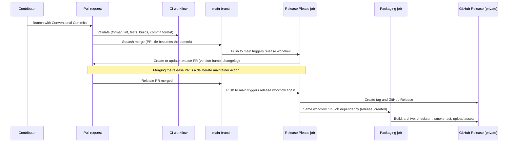

# Releases and CI/CD

**Status: plan.** No GitHub Actions workflows, release configuration, release manifests, or releases exist. This document describes the planned version control conventions, CI/CD workflows, release process, and artifact distribution. Version control conventions apply from the first commit. The workflows are built in milestone M1 (see [ROADMAP.md](ROADMAP.md)), and the release pipeline is hardened in M11.

## 1. Overview



## 2. Version control workflow

- **Branches.** Short-lived feature branches off `main`. One topic per branch. Unrelated changes go into separate branches and pull requests.
- **Commits.** Small, self-contained, and understandable on their own. Each commit should pass the relevant checks. Do not collect a large body of work into one commit.
- **Pull requests.** Changes normally reach `main` through pull requests. The owner explicitly authorized local commits directly on `main` for the 2026-10-12 template-scanner increment only (`D-010`). Direct pushes to `main` remain prohibited. Branch protection settings still require authorized setup and verification in M0.
- **Squash merges only.** Configured and verified on `eiserv/frameshift` on 2026-10-12: squash merging is enabled; merge commits and rebase merging are disabled. GitHub defaults to the pull request title as the commit subject and the pull request body as the commit body. Pull request titles must follow Conventional Commits. Only the squash commit reaches `main`, so Release Please does not read the individual branch commits as additional changes. This setting does not establish branch protection or validate commit messages automatically.
- **Documentation and verification.** Each meaningful change includes the documentation updates and tests it needs (see [TESTING.md](TESTING.md)).
- **Versions.** Never change version numbers by hand. Release Please manages them.

## 3. Conventional Commits

Commit messages and pull request titles follow [Conventional Commits 1.0.0](https://www.conventionalcommits.org/en/v1.0.0/) and are written in English:

```text
<type>(<optional scope>): <description>
```

| Type | Use | Effect on version |
| --- | --- | --- |
| `feat` | New user-visible capability | Minor |
| `fix` | Bug fix | Patch |
| `perf` | Performance improvement | Patch |
| `refactor` | Code change without behavior change | None |
| `docs` | Documentation only | None |
| `test` | Tests only | None |
| `build` | Build system, toolchain, dependencies | None |
| `ci` | CI configuration | None |
| `style` | Formatting only | None |
| `chore` | Maintenance | None |
| `revert` | Reverts a previous commit | Patch |

Types marked "None" do not trigger a release on their own and are hidden from the changelog. A breaking change marker raises any type to a major bump (or a minor bump before 1.0.0, see section 4).

Examples:

```text
feat(analyzer): detect static route dependencies
fix(parser): preserve source locations
perf(graph): reduce dependency traversal allocations
docs(architecture): define migration pipeline
refactor(core): simplify transformation dispatch
test(migration): cover dynamic route conversion
ci(release): add binary packaging
```

Recommended scopes are listed in section 8 of [ENGINEERING.md](ENGINEERING.md).

**Breaking changes** are marked with `!` after the type or scope (`feat(cli)!: rename --output to --out`), or with a `BREAKING CHANGE:` footer. With squash merges, the pull request title must carry the `!`, and any necessary footers must be copied deliberately into the squash commit message. A `Release-As: x.y.z` footer forces a specific version, for example to declare 1.0.0.

## 4. Versioning policy

Frameshift follows [Semantic Versioning](https://semver.org/).

- **Before 1.0.0:** Release Please is configured with `bump-minor-pre-major`. Breaking changes and features bump the minor version, and fixes bump the patch version. The first release is 0.1.0 (the M1 shell).
- **1.0.0** is declared deliberately with `Release-As: 1.0.0` when V1's acceptance criteria are met (see [ROADMAP.md](ROADMAP.md)). Product stages (V1, V2, V3) are not tied to major versions after that.
- **Breaking changes** include:
  - removing or renaming commands or options, or changing their meaning;
  - changing the meaning of exit codes;
  - breaking changes to JSON documents (which increment `schemaVersion`);
  - dropping a supported source version range or target profile.
- **Not breaking:** new commands, options, findings, or document fields. Improved rules that produce better output for the same input are features or fixes, and the changelog describes them so users can anticipate output differences between versions.
- **Recorded versions.** Every plan, report, and manifest records the engine version, ruleset, knowledge base, target profile, and weights versions, so results can always be attributed.

## 5. Release Please

### 5.1 Behavior

1. Every push to `main` runs the Release Please job. It reads the Conventional Commits since the last release.
2. If there are releasable changes, it opens or updates a single **release pull request** that bumps the version and updates `CHANGELOG.md`.
3. Merging the release pull request (a deliberate maintainer action) triggers the next run on `main`. That run creates the Git tag (`vX.Y.Z`) and the GitHub Release with release notes. The job outputs `release_created` and `tag_name`.
4. Packaging runs as a dependent job in the same workflow run and attaches the binaries to that release (section 6.3).

Configuration (decided in M1): manifest-based configuration with a single root package, tags without component prefix (`v0.1.0`), `bump-minor-pre-major`, and the `rust` release strategy, which updates the version in `Cargo.toml` (for a Cargo workspace, the workspace configuration is set up accordingly in M1). Changelog sections show features, fixes, performance improvements, reverts, and breaking changes. Other commit types are hidden.

### 5.2 `GITHUB_TOKEN` trigger behavior

GitHub Actions does not create new workflow runs for events caused by the built-in `GITHUB_TOKEN`, to prevent recursive runs. The exceptions are `workflow_dispatch` and `repository_dispatch`. For `pull_request` events (`opened`, `synchronize`, `reopened`) caused by a workflow using `GITHUB_TOKEN`, GitHub creates runs that require approval from a user with write access. This has two consequences:

- **Release pull request CI.** If Release Please used `GITHUB_TOKEN`, CI on the release pull request would wait for manual approval. Decision (`P-014`): the release job generates a short-lived token from a GitHub App that is installed only on this repository and has only the permissions Release Please needs. CI on release pull requests therefore runs automatically, and no long-lived personal token is involved.
- **Packaging trigger.** A release or tag created with `GITHUB_TOKEN` does not trigger workflows listening to `release` or `push: tags` events. Packaging will therefore run in the same workflow run, as a job that depends on the Release Please job and is conditioned on `release_created`. It is planned as a reusable workflow (`workflow_call`). For manual reruns, the packaging workflow will also accept `workflow_dispatch` with a tag input. That event type does create runs even when dispatched with `GITHUB_TOKEN`.

Illustrative structure (documentation only, not a workflow file):

```yaml
on:
  push:
    branches: [main]
jobs:
  release-please:
    permissions: { contents: write, pull-requests: write }
    outputs:
      release_created: ${{ steps.rp.outputs.release_created }}
      tag_name: ${{ steps.rp.outputs.tag_name }}
    steps:
      - id: rp
        uses: googleapis/release-please-action@<pinned commit SHA>
  package:
    needs: release-please
    if: needs.release-please.outputs.release_created == 'true'
    uses: ./.github/workflows/package.yml
    with:
      tag: ${{ needs.release-please.outputs.tag_name }}
```

## 6. Planned workflows

### 6.1 Overview

| Workflow (planned) | Trigger | Purpose |
| --- | --- | --- |
| CI | Pull requests (`opened`, `synchronize`, `reopened`, `edited` for title checks), pushes to `main` | Validation |
| Release | Pushes to `main`, manual dispatch | Release Please, then packaging |
| Package (reusable) | Called by Release, manual dispatch with a tag, pull requests that change packaging | Build, archive, checksum, smoke-test, upload |
| Scheduled verification | Schedule | Long-running test tiers (see section 7 of [TESTING.md](TESTING.md)) |

### 6.2 CI

- Formatting and linting with the language's standard tools.
- Static analysis: Clippy with the project's lint configuration (including the ban on wildcard arms over closed enumerations and on `unsafe` code), dependency boundary checks between crates, dependency audits and vulnerability scanning.
- Unit, fixture, golden, classification, negative, safety, determinism, and CLI end-to-end tests.
- Cross-platform test matrix (Linux, Windows, macOS, and ARM64 runners where available), scaled by the tiers in [TESTING.md](TESTING.md) to respect the Actions minutes available to private repositories.
- Cross-builds for every release target, to catch platform-specific build breaks early.
- Conventional Commit validation of the pull request title and of every commit subject in the pull request. This is a plain pattern check inside the workflow and needs no third-party action.
- Regression testing through the fixture corpus.

### 6.3 Packaging

1. Build the binary for each target with the pinned Rust toolchain and reproducibility flags (section 9), on native runners per operating system. Both macOS architectures can be built on an ARM64 macOS runner. Linux binaries are statically linked against musl, so they run on any distribution without depending on its glibc version. If musl's memory allocator measurably affects performance, a dedicated allocator is evaluated under its own decision record.
2. Smoke-test each binary on a native runner where one exists. `frameshift version` must report the tag's version and commit, and `frameshift inspect` must succeed on a small fixture.
3. Create deterministic archives (section 8).
4. Generate the checksum file.
5. Verify archive contents and checksums before upload.
6. Upload assets to the release with the GitHub CLI.
7. Pull requests that change packaging run steps 1 to 5 for one platform as a check, and store the results as short-lived workflow artifacts instead of uploading them.

## 7. Platforms

| Platform | Tier (planned) | Notes |
| --- | --- | --- |
| Linux x86_64 | 1 | Native runners |
| Linux ARM64 | 1 | GitHub provides Linux ARM64 standard runners for private repositories (2 vCPUs) |
| Windows x86_64 | 1 | Native runners |
| Windows ARM64 | 1 | GitHub provides Windows ARM64 standard runners for private repositories. Rust supports the `aarch64-pc-windows-msvc` target. |
| macOS ARM64 | 1 | Native runners |
| macOS x86_64 | 2 | Built (cross-compiled, or on an Intel runner while available). Intel macOS runner availability is declining, so the current runner labels must be checked when the workflows are built. Native testing happens only when such a runner exists. |

- **Tier 1:** built, full test suite on native runners, release artifacts smoke-tested natively.
- **Tier 2:** built, smoke-tested natively only when a runner is available. The release notes state the limitation.
- Platforms that are not listed are not provided. Frameshift does not promise a platform it cannot build and test.

## 8. Artifacts

### 8.1 Naming

```text
frameshift-<version>-<os>-<arch>.<ext>
frameshift-<version>-checksums.txt
```

- `<version>`: semantic version without the leading `v`, for example `1.4.0`.
- `<os>`: `linux`, `macos`, or `windows`.
- `<arch>`: `x86_64` or `arm64`.
- `<ext>`: `tar.gz` for Linux and macOS, `zip` for Windows.

Examples: `frameshift-1.4.0-linux-x86_64.tar.gz`, `frameshift-1.4.0-linux-arm64.tar.gz`, `frameshift-1.4.0-macos-arm64.tar.gz`, `frameshift-1.4.0-macos-x86_64.tar.gz`, `frameshift-1.4.0-windows-x86_64.zip`, `frameshift-1.4.0-windows-arm64.zip`, `frameshift-1.4.0-checksums.txt`.

Asset names never contain spaces: the GitHub CLI rewrites spaces in uploaded file names, which breaks links that expect the original name.

### 8.2 Archive contents

Each archive contains one top-level directory, `frameshift-<version>-<os>-<arch>/`, with:

- the binary (`frameshift` or `frameshift.exe`);
- `README.md`;
- `LICENSE`, once a license has been chosen (`DF-003`);
- `THIRD_PARTY_NOTICES.md`, if any third-party code is shipped.

### 8.3 Checksums

`frameshift-<version>-checksums.txt` lists the SHA-256 hash of every archive in the common `sha256sum` format, sorted by file name. Checksums detect corruption and accidental modification. They prove origin only together with signing or attestations (section 10).

## 9. Reproducibility and toolchain pinning

- **Toolchain pinning.** Rust 1.98.0, including rustfmt and Clippy, is pinned in `rust-toolchain.toml` for local builds (`D-032`). Future CI will use the same pin. Upgrades are deliberate `build` commits.
- **Build inputs.** Builds depend only on the source at the tagged commit, the pinned toolchain, and pinned dependencies. Version and commit are injected from the tag and commit. No timestamps or host information are embedded.
- **Path independence.** Absolute build paths are removed from binaries with Rust's path remapping options.
- **Deterministic archives.**
  - Entries are sorted.
  - File modification times come from `SOURCE_DATE_EPOCH`, which is derived from the commit time.
  - Ownership and permissions are normalized.
  - Gzip headers carry no name or timestamp, and zip entries use fixed timestamps.

  A small release tool in the project's own language may be preferable to platform `tar` and `zip`, because their behavior varies. Decided in M11.
- **Verification.** Before release, CI builds the Linux artifacts twice on different runners and compares checksums. A mismatch blocks the release.

## 10. Signing, provenance, and supply chain safeguards

| Mechanism | Value | Constraint | Plan |
| --- | --- | --- | --- |
| SHA-256 checksums | Integrity against corruption | Do not prove origin on their own | From the first release |
| GitHub artifact attestations (Sigstore-based build provenance) | Verifiable link between artifact, workflow, and commit | Private repositories require GitHub Enterprise Cloud | Public phase, or earlier if the plan allows |
| Immutable releases | Assets and tags cannot change after publication. Release attestations. | Assets must be attached before publication, which requires a draft-release flow | Experiment E5, then enabled no later than the public phase |
| Keyless signing of the checksum file | Origin verification independent of the GitHub interface | Adds a development tool | Evaluate for the public phase |
| macOS Developer ID signing and notarization | Gatekeeper accepts binaries downloaded through browsers | Apple Developer Program membership | Deferred (`DF-004`) |
| Windows Authenticode signing | SmartScreen reputation | Certificate cost | Deferred (`DF-004`) |
| Software bill of materials | Dependency transparency | Small value while dependencies are minimal | Evaluate, including embedding dependency information in the binary |

**Immutable releases and Release Please.** Release Please normally publishes the release immediately, and packaging attaches assets afterwards. With immutable releases enabled, those uploads would fail. The planned solution:

1. Release Please creates a **draft** release.
2. Packaging attaches and verifies the assets.
3. A final step publishes the release, which makes it immutable.

How Release Please handles tag creation for draft releases must be validated in experiment E5 before immutability is enabled. Until then, releases stay mutable, and checksums provide integrity.

**macOS downloads.** Unsigned binaries downloaded through a browser receive a quarantine attribute and are blocked by Gatekeeper. Downloads through the GitHub CLI or `curl` usually are not. Installation documentation will explain this until signing exists.

## 11. Permissions and secrets

- Workflows default to `permissions: contents: read`.
- The Release Please job gets `contents: write` and `pull-requests: write`. The packaging job gets `contents: write` for uploads. Attestations would additionally need `id-token: write` and `attestations: write`.
- Secrets are limited to the GitHub App credentials for release pull request CI. They are only available to the release job. Pull request workflows receive no secrets.
- All third-party actions are pinned to full commit SHAs. Updates are reviewed like dependency updates.
- Release workflows use a concurrency group, so overlapping runs cannot race.
- Workflow logs never print tokens or environment dumps.

## 12. Private phase restrictions

- Releases exist only in the private repository's GitHub Releases. They are accessible only to people with repository access, for example through `gh release download` with authentication.
- No public package registries, Homebrew taps, Scoop buckets, container registries, or download mirrors.
- No public release announcements.
- See section 10 of [SECURITY.md](SECURITY.md) for the general private phase rules.

## 13. Release checklist

1. `main` is green, including the scheduled verification tier.
2. Review the release pull request: version bump, changelog wording, and breaking change notes. Wording is fixed by correcting commit messages or using `Release-As`, not by editing the generated changelog by hand.
3. Confirm that the knowledge base and target profile versions are as intended.
4. Merge the release pull request.
5. Watch the release workflow: tag, release, packaging, checksums, smoke tests.
6. Download the artifacts on at least one platform, and check `frameshift version` and the checksum.
7. Update documentation if the release changes documented behavior.

## 14. Failure handling

- **Packaging fails after the release was created:** rerun packaging through manual dispatch with the tag. While releases are mutable, uploads replace partial assets.
- **A published release is broken:** publish a new patch version. Never move or reuse a tag.
- **Release Please produced a wrong version:** fix the cause (a commit type or footer) and use `Release-As` if needed. Never edit version numbers by hand.

## 15. Open items

- Release Please strategy and configuration for the chosen language (M1).
- Draft and immutable release flow (experiment E5, M11).
- Archive creation tool (M11).
- Current macOS Intel runner availability (M1).
