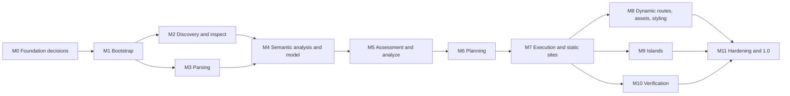
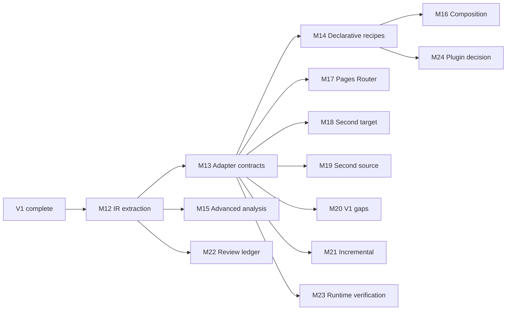

# Roadmap

**Status: plan.** Nothing on this roadmap is implemented. Milestones are defined by capabilities and technical dependencies, not by calendar dates (`D-014`). The three-stage strategy is an accepted decision (`D-016`). The contents of each stage are a plan and will be refined as work progresses.

**Stages versus version numbers.** "V1", "V2", and "V3" name product stages. They are not semantic version numbers. The first stable release, 1.0.0, is planned for when V1's acceptance criteria are met. After that, major version numbers follow breaking changes to the CLI and document contracts, not stage boundaries (see [RELEASES.md](RELEASES.md)).

## Overview

| Stage | Theme | Outcome |
| --- | --- | --- |
| V1 | Next.js to Astro migration MVP | A production-quality CLI that analyzes Next.js App Router projects, migrates the common static subset to Astro with Preact islands, reports feasibility and progress honestly, and verifies results |
| V2 | Extensible migration engine | A framework-independent intermediate representation, source and target adapters, declarative recipes, composition, and additional migration paths without rewriting the core |
| V3 | Universal migration platform | Substantially different frameworks, server-side features, cross-model and possibly cross-language transformations, advanced verification, and integrations, within documented fundamental limits |

## Stage V1: Next.js to Astro migration MVP

### Scope

The migration path `nextjs-to-astro-preact` as specified in [MIGRATION_SPEC.md](MIGRATION_SPEC.md): Next.js App Router projects (validated range 14.x to 16.x) to static Astro output with Preact islands. Pages Router projects are analyzed but not transformed.

### Goals

- A functional CLI with `inspect`, `analyze`, `plan`, `migrate`, `verify`, `report`, `rules`, and `explain` (see [CLI.md](CLI.md)).
- Discovery and analysis of Next.js projects, their configuration, dependencies, and lockfiles.
- Migration of static routes, layouts, dynamic routes with static parameters, common components, CSS and assets, and selected Preact islands.
- Basic dependency and build configuration migration.
- Rule-based compatibility analysis, with feasibility reporting, progress percentages, and human-readable diagnostics as defined in [MIGRATION_REPORTING.md](MIGRATION_REPORTING.md).
- Safe output generation that never touches the source project.
- Verification at the structural, build, and static output levels.
- Real value even when a project cannot be migrated completely: accurate analysis, partial migration of everything that can move, and precise manual tasks for the rest.

### Deliverables

- The `frameshift` binary for the supported platforms (see [RELEASES.md](RELEASES.md)).
- Versioned JSON document schemas for analysis, plan, report, and manifest.
- The V1 rule set with documentation and `explain` texts.
- Knowledge base v1: Next.js API catalog, curated package compatibility entries with evidence, Preact compat coverage, and the target profile `astro7-preact10`.
- Fixture corpus, golden tests, determinism and safety test suites.
- User documentation for every command, and updated specifications that match actual behavior.

### Milestones

Each milestone ends with a capability that is demonstrable and tested.

| Milestone | Capability | Main contents | Depends on |
| --- | --- | --- | --- |
| **M0** Foundation decisions | Core techniques validated in Rust | Experiments E1 (parser and tree design) and E2 (edit-based rewriting and Astro printing). `P-002` and `P-003` accepted or replaced. Rust toolchain version chosen. Private GitHub repository and branch protection set up, with the user's authorization. | None |
| **M1** Bootstrap and engine skeleton | A buildable, tested, releasable shell | Package layout following the architecture's layers. Foundation layer: findings, identifiers, path model, deterministic collections, limits. `frameshift version` and `help`. Golden and determinism test harnesses. CI with formatting, linting, tests on three operating systems, cross-builds for all targets, and Conventional Commit checks. Release Please and basic packaging with checksums. | M0 |
| **M2** Discovery and inspection | `frameshift inspect` | Safe filesystem walker (symbolic link policy, limits, ignore rules including `.gitignore`). Snapshot store with hashing. JSON and JSONC parsers. Package manifest model. Lockfile parsers (npm, pnpm YAML subset, Yarn classic and Berry, Bun text). Workspace detection. Framework, version, and router detection. Adversarial fixtures. | M1 |
| **M3** Parsing | Production parsers | JS, TS, JSX, and TSX parser evolved from E1. CSS and SCSS tokenizer and structural parser. Position tables, comment lists, resource limits. Conformance suites. Continuous fuzzing. | M1 (and E1) |
| **M4** Semantic analysis and project model | Facts about any App Router project | Module resolution including `tsconfig` paths. Scopes and bindings. Module and component graphs. Route tree. Render contexts. Environment classification. Static evaluator (with experiment E3 measuring evaluation coverage). Next.js fact extraction. Golden snapshots of the project model. | M2, M3 |
| **M5** Assessment and analysis report | `frameshift analyze`: **first user value** | Feature catalog for the V1 matrix. Assessment rules. Unit classification and route readiness. Knowledge base v1. Metrics with `weights-v1` validated against real projects (`Q-002`). Report schema v1. Text rendering, `report`, `explain`, and verdicts. | M4 |
| **M6** Planning | `frameshift plan` | Configuration file `frameshift.jsonc` with its JSON Schema. Output path mapping for the conventional Astro layout, with collision detection. Rule registry with exclusivity checks. Operation generation. Plan document, hashing, and binding. Manual tasks. `migrate --dry-run` file listing. | M5 |
| **M7** Execution and static sites | `frameshift migrate` for sites without client components | Executor: staging, atomic commit, overwrite policies, manifest, staging cleanup. Edit engine and Astro printer from E2. Structural verification. Rules: static routes, segments, groups, private folders, layout chain, static metadata and metadata files, Astro and static Preact components, `next/link`, global CSS, CSS Modules, Sass, public and imported assets, configuration generation, preservation of unmigrated files, `.frameshift/SUMMARY.md`. | M6 (and E2) |
| **M8** Dynamic routes, assets, styling | Common content sites | Dynamic routes with static parameters (including composition), catch-all routes, root not-found, special files, static GET route handlers, generated metadata routes, `next/image` (both strategies), `next/font`, `next/script`, Tailwind CSS v3 and v4, PostCSS, environment variable rewriting (`Q-003` resolved), metadata helper for non-literal metadata. | M7 |
| **M9** Client components and islands | Interactive sites | Island selection, `client:load`, `client:only` for `ssr: false`, the compat strategy with package aliases and overrides for every supported package manager, boundary prop analysis and named slots, navigation helper, context scope classification, hook coverage, knowledge base entries for curated React libraries backed by fixtures. | M7 |
| **M10** Verification | `frameshift verify` | External tool runner (authorization, temporary copies, environment scrubbing, timeouts, log capture). Build level. Static output level with HTML normalization and per-route comparison (experiment E4 decides the HTML parser, `Q-005`). Per-unit verification evidence. | M7. Full value after M8 and M9. |
| **M11** Hardening and 1.0 | Release readiness | Cross-platform determinism suite. Benchmarks against budgets. Security review of every threat model control. Private real-world evaluation report. Complete user documentation. Release pipeline hardening (reproducibility check, platform smoke tests, experiment E5 on draft and immutable releases). Release 1.0.0 (private). | M8, M9, M10 |

M2 and M3 can proceed in parallel, and so can M8, M9, and M10. M5 is deliberately early: an accurate analysis report is useful on its own, and it validates the model and the metrics before any transformation work starts.

### Minimum supported rule set

At V1 completion, every `A` and `R` entry of the compatibility matrix in section 17 of [MIGRATION_SPEC.md](MIGRATION_SPEC.md) is handled, except entries marked "later". In summary:

1. **Project and configuration:** App Router detection. Static evaluation of `output`, `trailingSlash`, `basePath`, `images`, `env`, simple `redirects`, and keys that are safe to drop. `tsconfig` and `jsconfig` mapping. Package manifest and script transformation. Lockfile carry-over.
2. **Routing:** static pages, nested segments, route groups, private folders, dynamic segments with `generateStaticParams` (single-level automatic, parent-dependent with review), catch-all and optional catch-all routes, root not-found, special files with review handling, static GET route handlers.
3. **Layouts and metadata:** layout chains, static metadata with merge semantics for the supported fields, metadata files, and a helper for non-literal metadata.
4. **Components:** the full conversion ladder: Astro components, static Preact components, Preact islands with `client:load` and `client:only`, boundary props including named slots, and the compat strategy.
5. **Next.js APIs:** `next/link`, `next/image`, `next/font`, `next/script`, `next/dynamic`, `next/navigation` hooks, and removal of `server-only` and `client-only`.
6. **Styling and assets:** global CSS, CSS Modules, Sass, Tailwind CSS v3 and v4, PostCSS, `public/`, and static imports.
7. **Dependencies:** removal and addition of framework packages, compat aliases, and knowledge base classification of curated libraries.
8. **Detection and explanation** for every `U` entry, so no unsupported construct goes unreported.

### Realistic example projects

These describe the kinds of projects V1 is designed for. Expected outcomes are design targets.

| Project | Characteristics | Expected V1 outcome |
| --- | --- | --- |
| Personal portfolio | 6 static routes, Tailwind CSS v4, a theme toggle client component using `localStorage`, a contact form posting to an external service with client-side `fetch` | Fully migrated. The toggle becomes an island. Review items for navigation semantics and fonts. |
| Marketing site with a blog | Markdown posts read with `fs` in server components, `generateStaticParams`, unoptimized `next/image`, `sitemap.ts` | Fully migrated with review items (sitemap endpoint, fetch semantics) |
| Documentation site | Catch-all docs route, a client-side search box, a sidebar using `usePathname` | Migrated with review items (navigation helper, catch-all adaptation) |
| Small business site deployed as a Next.js server | Default image optimizer, `next/font`, a contact form using a Server Action | Partial: every route except `/contact` is migrated. The Server Action becomes a manual task. |
| Application with authentication | `next-auth`, proxy or middleware, cookies on most routes | Poor candidate verdict. The analysis explains why. Little or nothing is migrated. |

### Testing requirements

V1 requires the test categories in [TESTING.md](TESTING.md): parser conformance and fuzzing, per-feature fixtures with golden outputs, labeled classification fixtures, negative fixtures for every unsupported feature, determinism tests across platforms, safety tests, build verification of fixture outputs in CI, static output comparison on composite fixtures, browser-based hydration checks for island fixtures in Frameshift's own CI, and performance benchmarks.

### Acceptance criteria

V1 is complete when all of the following hold:

1. **Fixtures.** At least 40 single-feature fixtures (covering every `A` and `R` matrix entry and every `U` entry) and at least 5 composite fictional sites pass golden tests on Linux, Windows, and macOS.
2. **Determinism.** Plans, output trees, manifests, and reports (excluding `run` metadata) are byte-identical across two runs with different degrees of parallelism, and across the three operating systems.
3. **Supported composites.** Every composite fixture designated as fully supported reaches 100% `auto` or `review` assessment, builds with the pinned target profile, and passes static output comparison for every route: identical route set, identical normalized text, identical link targets, identical supported head metadata, and identical image references and alternative texts.
4. **JavaScript reduction.** Static-only fixtures produce zero client-side JavaScript. Island fixtures ship JavaScript only for islands, and each island hydrates and responds to a scripted interaction in Frameshift's CI harness.
5. **Honesty.** On labeled fixtures, no unit is classified `auto` when its expected label is anything else (zero false `auto`). Every unsupported construct in negative fixtures produces the correct finding code and location.
6. **No silent loss.** The file accounting invariant holds for every fixture and real-world project. Output never contains residual `next/*` imports or `'use client'` directives unless they are reported.
7. **Real-world evaluation.** At least 10 real-world Next.js App Router projects, chosen to be static-leaning and with licenses that permit the use, are analyzed and migrated without internal errors. A human review of a sample of `auto` units finds no false `auto` classification. Results are documented in a private evaluation report.
8. **Safety.** Automated tests prove that the source is never modified, nothing is written outside the output location, no external process runs without `--allow-exec`, symbolic links that escape the root are excluded, and unsafe output paths are rejected.
9. **Performance.** The budgets in section 4 of [ENGINEERING.md](ENGINEERING.md) are met on reference hardware.
10. **Documentation.** Every command, finding code, and rule is documented. Every document in `docs/` matches actual behavior, and planned items are still marked as planned.
11. **Release.** A tagged release with binaries for all supported platforms, checksums, and passing smoke tests.

### Technical risks

| Risk | Impact | Mitigation |
| --- | --- | --- |
| Parser effort is underestimated | Delays M3 and everything after it | E1 before M1. Specifications and conformance suites. Explicit fallback paths in `P-002`. |
| Next.js changes quickly | Rules become outdated | Version ranges on rules, version detection, conservative behavior for unknown versions, knowledge base updates |
| Astro and Preact change | Target profile churn (Astro 8, Preact 11) | Pinned and tested target profiles. Profile updates as deliberate releases. |
| False `auto` classifications | Silent regressions, loss of trust | Fail-closed design, a zero false `auto` acceptance criterion, verification levels, real-world review |
| Noisy static output comparison | False alarms from framework-specific markup | Documented normalization rules (E4), measured false-difference rate on fixtures |
| Many unknown third-party packages | Low perceived value | Curated knowledge base backed by evidence. Clear guidance. Analysis value even for partial migrations. |
| Real-world variety exceeds fixtures | Unexpected failures | Real-world evaluation from M5 onward, findings fed back into fixtures |
| Platform differences (paths, line endings, case) | Nondeterministic output | Determinism rules in code, cross-platform CI from M1 |
| Verification executes untrusted code | Compromise of the user's machine | Explicit authorization, temporary copies, scrubbed environments, clear documentation recommending disposable environments |
| Scope creep (Pages Router, MDX, SSR in V1) | Diluted quality | Explicit non-goals. Additions require a roadmap change. |
| Graph-shaped data and long compile times in Rust | Slower iteration, awkward designs | Arena and index designs validated in E1, a deliberate crate structure |

### Non-goals for V1

- Transformation of Pages Router projects, MDX pages, CSS-in-JS, or context shared across islands.
- Any migration of request-time server features: middleware or proxy, Server Actions, request-dependent route handlers, cookies, headers, draft mode, ISR.
- Server-rendered (SSR) Astro output or server adapters.
- Automatic hydration optimization, output layout normalization, or other opt-in optimizations.
- Migrating test suites, CI workflows, deployment configuration, or linter configuration (all reported as manual tasks).
- Any GUI, web interface, editor integration, or model-assisted processing.

### Conditions for moving to V2

1. V1 acceptance criteria are met and 1.0.0 is released privately.
2. The real-world evaluation shows practical value, and there are no open defects causing false `auto` classifications or data loss.
3. A documented analysis identifies which parts of the project model are specific to Next.js or Astro and need generalization, based on evidence from V1.
4. The second source framework is selected (`DF-011`), using demand, structural distance, and testability as criteria. The second target, Astro with React islands, is already decided (`D-031`).
5. A plan exists for any breaking changes to JSON documents that V2 requires.

## Stage V2: Extensible migration engine

### Scope

Generalize the V1 engine into a platform that supports several migration paths on a shared core: a framework-independent intermediate representation, source and target adapters, declarative recipes, stronger graphs and semantic analysis, rule composition and conflict detection, incremental and resumable execution where justified, better validation, expanded reporting, additional migration paths, well-defined internal interfaces, and a plugin mechanism only if it provides real value.

### Goals

- Adding a migration path requires an adapter and recipes, not changes to the core.
- Framework-specific concepts are preserved as facets, and pair-specific recipes coexist with generic ones (section 10 of [ARCHITECTURE.md](ARCHITECTURE.md)). No pretense of a perfect universal representation.
- V1 behavior is preserved exactly through the refactoring.
- Verification extends to runtime behavior for selected checks.

### Deliverables

- An IR specification (a new document, created when the work starts).
- Source and target adapter contracts.
- A versioned recipe format with a validator.
- At least one additional source and one additional target.
- Pages Router support.
- Resumable execution, a review ledger, an event stream for integrations, and opt-in runtime verification.

### Milestones

| Milestone | Capability | Depends on |
| --- | --- | --- |
| **M12** IR extraction | The project model becomes a common core plus facets. V1 rules consume the IR. All V1 golden outputs stay byte-identical, which proves the refactoring. | V1 |
| **M13** Adapter contracts | Next.js and Astro + Preact sit behind source and target adapter interfaces. Import-boundary checks prove that core layers contain no path-specific code. | M12 |
| **M14** Declarative recipes | Mapping-type rules (API mappings, import rewrites, attribute renames, configuration keys) are expressed as validated, versioned data. Complex transformations remain code. | M13 |
| **M15** Advanced analysis | Complete re-export and barrel resolution, symbol-level usage, prop data flow (functions versus data), and reading of declared types without inference | M12 |
| **M16** Composition and conflict detection | Multiple rules per construct with explicit ordering and priorities, detection of overlapping edits, conflict reports | M14 |
| **M17** Pages Router | `getStaticProps`, `getStaticPaths`, `_app`, `_document`, `next/head`, and `next/router` handled for static Pages Router projects | M13 |
| **M18** Second target | Astro with React islands (`D-031`), a small domain change that isolates the target adapter abstraction | M13 |
| **M19** Second source | Candidate: Gatsby or a Vite-based React single-page application (decision `DF-011`) | M13 |
| **M20** High-demand V1 gaps | Context shared across islands (shared store transformation), `styled-jsx`, MDX pages, optional Astro client router | M13 |
| **M21** Incremental and resumable execution | Opt-in analysis cache keyed by content hash and engine version. Execution journal and resume. Outputs identical to uninterrupted runs. | M13 |
| **M22** Review ledger and CI mode | Recorded review acknowledgments, review state in reports, CI gating on review state, NDJSON event stream | M12 |
| **M23** Runtime verification | Opt-in headless browser checks (hydration, scripted interactions, accessibility tree comparison) using a user-installed browser under explicit authorization | M13 |
| **M24** Plugin decision | Evaluation of third-party rule development needs. Implement an out-of-process protocol only if justified, otherwise record the rejection (`DF-002`). | M14 |

### Acceptance criteria

1. At least two sources and two targets run on the shared core, and automated checks show no path-specific code in core layers.
2. All V1 golden outputs are unchanged by the V2 refactoring, except for deliberate, documented rule improvements.
3. Mapping-type rules are expressed as recipes, and recipe validation rejects malformed or conflicting recipes with clear diagnostics.
4. Conflict detection is covered by tests for overlapping edits and ordering constraints.
5. Resumed executions produce byte-identical outputs to uninterrupted runs.
6. Runtime verification runs on all island fixtures of every supported target.
7. Every new migration path meets acceptance criteria equivalent to V1's within its own scope.
8. Documentation covers the IR, adapter contracts, and recipe format.

### Technical risks

| Risk | Mitigation |
| --- | --- |
| Overgeneralized IR that hides framework semantics | A concept enters the core only when two adapters need it with compatible meaning. Everything else stays in facets. |
| The recipe format grows into a programming language | Recipes cover mapping-type rules only. Complex logic stays in reviewed code. |
| Abstraction costs performance | Benchmarks against V1 budgets in CI |
| Plugin security and compatibility surface | Plugins only if justified. Out-of-process execution with no ambient authority. |
| Several target profiles to maintain | One profile per target for the current major version (`D-028`). Old profiles are retired explicitly. |

### Non-goals for V2

- Server-rendered targets and migration of server features (V3).
- Translation between different component models, such as React to Svelte or Vue (V3).
- Any dependency on an LLM, a GUI, or arbitrary backend migration.

### Conditions for moving to V3

1. V2 acceptance criteria are met.
2. The recipe format is stable, versioned, and documented.
3. Runtime verification is available for supported targets.
4. Evidence of demand exists for server-side features, other frameworks, or cross-model migration.
5. Maintenance cost of existing paths is under control: bounded test times and no growing backlog of correctness defects.

## Stage V3: Universal migration platform

### Scope

A migration platform for substantially different frameworks, architectures, and possibly languages. V3 is organized into capability tracks rather than one linear sequence. Detailed milestones for each track are defined when V3 starts.

| Track | Capability | Prerequisites |
| --- | --- | --- |
| T1 Server-capable targets | Astro with server adapters. Mapping Server Actions to Astro Actions, route handlers to server endpoints, and proxy or middleware to target middleware where semantics align. | V2 adapters, runtime verification |
| T2 More frameworks | Sources and targets such as Nuxt, SvelteKit, Remix or React Router, Gatsby | V2 adapter contracts and recipes |
| T3 Cross-component-model translation | Constrained React, Vue, Svelte, and Solid component subsets. Reactivity and lifecycle mapping. | IR maturity, advanced analysis |
| T4 State management migration | Context, Redux, and similar stores mapped to signals or target stores | T3 foundations, data-flow analysis |
| T5 Cross-language transformations | Research track for well-bounded cases, for example template languages of server frameworks | Explicit feasibility studies |
| T6 Deeper semantic analysis | Optional type information through Frameshift's own inference subset or an external type checker behind a process boundary | M15 |
| T7 Advanced verification | Differential testing, visual regression, accessibility comparison, property-based behavioral checks | M23 |
| T8 Architecture recommendations | Deterministic, explainable analyses such as "this route has no request-time dependency and can be static" | Mature analysis |
| T9 Integrations | A CI action wrapper, editor or language server integration, an optional GUI (`DF-006`), all using the engine API | Engine API and event stream |
| T10 Optional model assistance | Narrow decision support as defined in [LLM_POLICY.md](LLM_POLICY.md) | Evaluation corpus, policy controls |

### Goals and deliverables

Each track delivers migration paths or capabilities that meet acceptance criteria equivalent to V1's within their scope, with the same guarantees: determinism, fail-closed classification, honest reporting, and safety.

### Acceptance criteria (per track)

- New migration paths: labeled fixtures with zero false `auto`, golden tests, determinism, verification at the strongest available level, and documented limits.
- Server-capable targets: verification includes runtime behavior of server features in isolated environments.
- Model assistance: meets every requirement and evaluation criterion of [LLM_POLICY.md](LLM_POLICY.md), stays opt-in, and never alters deterministic results silently.
- Frontends and integrations: use only the engine API and documents, and contain no migration logic.

### Technical risks

- Combinatorial growth of paths and profiles. Mitigation: a shared core, recipes, and an explicit support policy.
- Semantic gaps between execution models, which make many constructs `review` or `unsupported`. Mitigation: honest classification, never optimistic guessing.
- User expectations of "universal". Mitigation: published limits, conservative wording, and no marketing claims.
- Misuse or over-trust of model assistance. Mitigation: the constraints in [LLM_POLICY.md](LLM_POLICY.md).

### Non-goals for V3

- Guaranteed behavioral equivalence for arbitrary software.
- Translating arbitrary systems between languages.
- Autonomous, unreviewed AI rewriting of code.
- Replacing human acceptance testing.

### Fundamental limits

The limits in section 22 of [ARCHITECTURE.md](ARCHITECTURE.md) apply to every stage. Cross-language work in V3 adds more:

- Runtime semantics differ: numeric types, string encoding, concurrency and memory models, error handling, and standard library behavior.
- Ecosystem gaps: a library in one language often has no equivalent in another.
- Idioms do not translate: mechanically translated code is often unmaintainable even when it is correct.

V3 therefore treats cross-language transformation as research with explicit feasibility studies, not as a promised capability.
