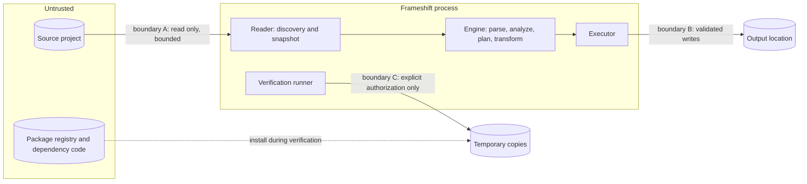

# Security

**Status: initial threat model and planned controls.** The M0 text, lexical, parsing, and rewriting primitives have no I/O. They reject invalid UTF-8, invalid spans, malformed strict-string escapes or numeric literals, unclosed lexical constructs, overlapping edits, ambiguous ordering, and resource limits with typed errors and no partial result. The parser bounds node, token, comment, and nesting counts, detects duplicate parameters by sorting rather than pairwise comparison, and tracks declarations in hash-keyed transient scopes, so hostile parameter and declaration lists cannot cause quadratic work. At the default nesting bound, an optimized build uses about 350 KiB of stack. Lexical scans are iterative, strings, numbers, punctuation, and template segments allocate no storage, and comment retention is bounded. Punctuation and template scans require explicit caller-selected lexical context and never guess regular-expression or substitution boundaries. Invalid untagged template escapes fail; tagged templates retain the first invalid escape as evidence of an undefined cooked value. Segment byte limits bound scanning, including long malformed escapes. Identifier characters are classified with generated, pinned Unicode 18.0.0 tables rather than toolchain-dependent predicates. Identifier escapes must denote permitted code points, and reserved words are reported from the decoded StringValue without allocation. Regular-expression literals are validated without compiling or executing them, so hostile patterns cannot trigger backtracking. The pattern validator is iterative with explicit stacks, so deep nesting cannot exhaust the call stack, and its storage is proportional to the pattern and reserved fallibly. Unsafe Rust is forbidden in product crates; the development-only measurement harness and fuzzer confine reviewed unsafe code to one module each and to a crate of two section markers (`D-040`, `D-044`). The development-only processor-time helper is written in Go without the `unsafe` package, starts only the program it is given, and writes only a new log file (`D-046`). The Astro printer embeds only validated names, escapes every text and attribute value for HTML and Astro, prints string literals with JavaScript escapes, and rejects copied frontmatter that would end the frontmatter fence, so source content cannot inject markup or code. The development-only E2 driver reads its fixtures and writes only golden files below them or a new output directory with checked relative paths. Their scope and limits are recorded in [IMPLEMENTATION.md](IMPLEMENTATION.md). The CLI help and version shell reads arguments and writes standard streams only. It rejects malformed native argument encoding, never echoes argument text into diagnostics, and does not inspect projects or execute external code. Compiler identity is captured at build time by invoking Cargo's compiler only (`D-050`). Source discovery, filesystem safety, execution authorization, and the remaining product controls below are not implemented. This document defines the security direction for the migration engine, the privacy requirements, publication preparation and the separate binary release gate. The public reporting entry point is [../SECURITY.md](../SECURITY.md); the technical threat model below deliberately retains planned controls as plans.

## 1. Scope

**Implemented M1 supply-chain controls (`D-051`, `D-052`).** CI uses full SHA-pinned Actions and read-only tokens, including the reusable packaging workflow. Checkout credentials are not persisted. Release PR automation uses a short-lived token from an App installed only on Frameshift, with no administration access. The private key is stored only as an Actions secret, read through the `release` environment that only `main` may use. Repository settings allow only GitHub-owned Actions and Release Please, and require every Action to be pinned to a full commit SHA. Publication has a separate M1 gate and a contents-write upload job. The Go release helper uses standard-library SHA-256 and compression, verifies archived bytes and modes, and refuses to overwrite artifact files. Third-party table notices are included in every archive. These controls do not implement the future source filesystem or executor protections.

- Security of users who run Frameshift on projects that may be hostile.
- Privacy of the source code and secrets in those projects.
- Integrity of Frameshift's outputs, reports, and release artifacts.
- Protection of credentials, analyzed projects, and non-public evaluation data during and after the visibility transition.

## 2. Principles

1. **Source repositories are untrusted input** (`D-008`). Every file name, file content, link, and configuration value may be crafted by an attacker.
2. **Static analysis first.** Frameshift understands projects by parsing them, never by running them. Executing project code requires explicit, per-invocation authorization.
3. **Least authority.** Each phase has only the access it needs. Analysis reads, planning computes, execution writes to one location, and only authorized verification starts processes.
4. **No silent data flow.** No telemetry, no network calls, and no upload of project content (`D-012`).
5. **Fail closed.** Anything unexpected is reported and excluded, never processed optimistically.
6. **Honest limits.** Frameshift documents what it does not protect against (section 13).

## 3. Assets

| Asset | Why it matters |
| --- | --- |
| The user's machine (files outside the project, credentials, other repositories) | Compromise through a hostile project would be the worst outcome |
| The source project | Must never be modified or damaged |
| Secrets inside the source project (`.env` files, keys in code) | Must never be copied, printed, or embedded in reports |
| The output project | Must contain only what the plan specifies, with no injected content |
| Reports and plans | May be shared in CI or with colleagues, so they must not leak sensitive data |
| Frameshift's own source code and release artifacts | Supply chain integrity for every user |

## 4. Adversaries and trust levels

| Source | Trust level |
| --- | --- |
| Command-line arguments from the user | Trusted: they express the user's intent |
| The source project, including all files, names, links, and configuration | Untrusted |
| Frameshift's own rules, knowledge base, and target profiles | Trusted: shipped and reviewed with the binary |
| Plan documents passed back to `migrate --plan` | Untrusted: the plan is recomputed, never executed from the file |
| Output of external tools during verification | Untrusted data |
| Package registries and dependency code (verification only) | Untrusted |

The main adversary is the author of a malicious repository: for example, a cloned demo project, a contribution, or a compromised dependency checked into a project. The adversary controls everything inside the source root.

## 5. Trust boundaries

- **Boundary A, source to reader:** read-only, bounded by limits, no link following outside the root.
- **Boundary B, engine to filesystem:** writes only to the staging and output locations, through validated relative paths.
- **Boundary C, verification runner to external processes:** only with `--allow-exec`, only on temporary copies, with a scrubbed environment.

There is no boundary to the network in Frameshift itself. A future optional model-assisted subsystem would add one, under the rules of [LLM_POLICY.md](LLM_POLICY.md).

## 6. Threat model

| # | Threat | Vector | Impact | Planned controls |
| --- | --- | --- | --- | --- |
| T1 | Code execution during analysis | `next.config.js`, `tailwind.config.js`, `postcss.config.js`, or any module executed to read configuration | Full compromise | Never execute project code. Static evaluation over a safe subset only (section 7.3). |
| T2 | Code execution during verification | Package lifecycle scripts, build plugins, configuration files executed by build tools | Full compromise | `--allow-exec` required. Temporary copies. Lifecycle scripts disabled by default. Scrubbed environment. Clear notices and documentation recommending disposable environments (section 7.4). |
| T3 | Reading outside the project | Symbolic links or junctions pointing outside the root | Disclosure of files such as SSH keys in reports or output | Links not followed by default. Escaping links excluded and reported (`FS1003`). |
| T4 | Writing outside the output | Crafted file or route names producing `..`, absolute paths, drive letters, or alternate data streams | Overwriting arbitrary files | Output paths built only from validated canonical relative segments, without repairing ambiguous input. Rejection of traversal, absolute paths, reserved names, and control characters (`FS7003`). |
| T5 | Destroying user data | Output location pointing at an existing directory, home directory, or the source | Data loss | Default refusal of existing output. Managed replacement only for unmodified Frameshift output. Previous output moved aside, never deleted. Source and home directory never accepted as output (section 7.5). |
| T6 | Denial of service | Deeply nested code, huge files, millions of files, pathological constructs | Crash, hang, memory exhaustion | Deterministic limits on depth, size, and counts. Fuzzing. Iterative algorithms where depth is unbounded (section 7.2). |
| T7 | Injection into generated code | Source strings (metadata titles, attribute values) containing markup or code delimiters | Script injection into the migrated site | Context-specific escaping in all printers. Injection fixtures (section 7.6). |
| T8 | Secret leakage | `.env` files, credentials in code, secrets in reports shared through CI | Credential compromise | `.env` files never read or copied. JSON reports exclude snippets by default. No absolute paths in documents (section 7.7). |
| T9 | Terminal or report injection | File names or strings with ANSI escape sequences, or Markdown and HTML payloads | Misleading output, terminal manipulation | Control characters escaped in terminal output. Context escaping in Markdown and other renderers (section 7.8). |
| T10 | Tampered plan document | A modified `plan.json` passed to `migrate --plan` | Unintended operations | Plans recomputed from the source and compared by hash. File contents never executed (section 7.9). |
| T11 | Data exfiltration | Network access, telemetry, or automatic upload | Disclosure of private code | No network access in Frameshift. No telemetry without an explicit decision (section 7.10). |
| T12 | Supply chain compromise of Frameshift | Malicious dependencies, compromised CI, tampered releases | Every user affected | Minimal dependencies, pinned toolchains and Actions, least-privilege workflows, checksums, and later signing and provenance (section 9) |

## 7. Controls

### 7.1 Read-only source access and traversal

- Source files are opened for reading only. No command has an option to write into the source.
- Discovery never leaves the root. Symbolic links are not followed by default. Links resolving inside the root are recorded as references. Links resolving outside are excluded with `FS1003`. Windows junctions and reparse points are treated like links.
- Device files, named pipes, and sockets are skipped and reported.
- All reads go through the snapshot, so a file is read once. Its hash then identifies it for the rest of the run, which also prevents time-of-check to time-of-use races between stages.
- `node_modules/` is never read.

### 7.2 Resource limits

- Deterministic limits on maximum file size for parsing, total files, total bytes, directory depth, syntax nesting depth, and token counts per file. Defaults are documented, and a limit that is reached produces a finding.
- Parsers either avoid recursion where input controls the depth, or enforce an explicit depth bound well below the stack limit.
- Future parser recovery has explicit per-file diagnostic and recovery-work limits, guarantees forward progress, and stops if lexical context cannot be synchronized safely (`D-034`). Recovery never makes an erroneous file eligible for transformation.
- Limits are based on size and counts, not time, so results stay deterministic. External tools in verification have timeouts, because their behavior is outside Frameshift's control.

### 7.3 No execution of project code

- Configuration files are parsed and evaluated statically. The evaluator understands literals, object and array literals, template literals with known parts, `const` bindings, and constant imports from local files. Everything else becomes `Unknown(reason)`.
- The evaluator has no access to the filesystem, environment, network, or clock, so it can never perform side effects.
- Build-time code (server components, `generateStaticParams`) is moved into the output, never run by Frameshift.
- A `frameshift.jsonc` inside the source project is untrusted like every other file. It cannot enable code execution, change overwrite policies, choose the output location, or reference paths outside the source root (section 5.1 of [CLI.md](CLI.md)).

### 7.4 External tool execution (verification only)

- Requires `--allow-exec` on every invocation, including V1 runtime browser checks (`P-013`). There is no persistent setting that enables it.
- Before running anything, Frameshift prints a notice naming the tools and stating that dependencies and configuration will execute code.
- Tools run on temporary copies of the output (and of the source, for static output comparison), never on the user's directories.
- The environment is scrubbed: only variables required for the tools to work are passed (such as `PATH`, the temporary home and cache directories, and the locale). Tokens and credentials (`NPM_TOKEN`, `GITHUB_TOKEN`, cloud credentials) are not passed.
- Package lifecycle scripts are disabled by default where the package manager supports it. `--allow-install-scripts` re-enables them explicitly.
- Each command has a timeout. Captured output is size-limited and treated as untrusted text.
- Runtime verification uses a user-installed browser on temporary builds. Browser tooling, local serving, interaction inputs, and isolation controls must be specified and reviewed in M10 before implementation. Browser observations do not authorize executing additional project code or widening filesystem access.
- Frameshift provides no operating system sandbox in V1 (section 13). Documentation recommends running build-level verification in containers, virtual machines, or ephemeral CI runners.

### 7.5 Output safety

**Implemented value boundary (`D-054`).** `OutputPath` checks canonical relative structure and portable individual names in memory, after `SourcePath` validation. It rejects traversal, native prefixes, backslashes, NUL and controls, alternate data stream punctuation, device names, trailing spaces/dots, and overly long components on every host. Limits bound input bytes and component count; typed errors never echo source names. This does not establish root containment or detect collisions and links. The filesystem controls below remain executor requirements. See section 14 of [IMPLEMENTATION.md](IMPLEMENTATION.md).

- The output location must not exist or must be empty, unless `--on-existing replace-managed` applies.
- The output must not be the source, inside the source, or contain the source. It must not be a filesystem root or the user's home directory.
- Writes go to a staging directory next to the output, then are committed atomically by rename.
- `replace-managed` requires a valid Frameshift manifest, and every file must still match its recorded hash. Modified output is never replaced (`FS7004`). The previous output is moved aside, not deleted.
- Staging cleanup removes only directories that carry Frameshift's staging marker.
- Output paths are validated: no traversal, no absolute paths, no drive letters or alternate data streams, no Windows reserved names, no control characters, and no collisions that differ only in case or Unicode normalization.

### 7.6 Generated code safety

- Printers never concatenate source-derived strings into code. Each value is emitted through an escaping function for its context: HTML text, HTML attribute, JavaScript string literal, template literal, JSON, or Astro template expression.
- Source code copied verbatim stays verbatim. That is not injection, because it is the project's own code in its own context.
- Fixtures with hostile strings (closing tags, quotes, template delimiters, Unicode line separators) verify the escaping.

### 7.7 Secrets and privacy

- Environment files (`.env`, `.env.local`, `.env.*`) are neither read nor copied. Analysis uses only references in code (`process.env.X`). The output gets a manual task to recreate environment configuration. Example files intended for sharing (such as `.env.example`) are treated as ordinary source files.
- JSON reports and plans contain no source snippets unless `--include-snippets` is given. Terminal output may show short snippets, because it stays on the user's machine.
- Documents contain only paths relative to the source root. They never contain absolute paths, user names, host names, or environment values.
- Source code is never sent anywhere. Frameshift has no network client.
- Secret detection inside source files (for example, hard-coded API keys) is not a V1 feature. Frameshift does not claim to find or remove secrets in code.

### 7.8 Terminal and report injection

- All source-derived strings printed to a terminal have control characters escaped, including ANSI escape sequences and carriage returns.
- Markdown output escapes source-derived text. HTML rendering, if ever added, escapes by context.

### 7.9 Plan and manifest integrity

- `migrate --plan` recomputes the plan and requires an identical hash (`P-005`). The plan file's contents are never interpreted as operations.
- Manifests record output file hashes. `verify` and `replace-managed` use them to detect modifications. Manifests are integrity records, not security signatures: a person who can edit the output can also edit its manifest.

### 7.10 Network and telemetry

- Frameshift makes no network connections during inspection, analysis, planning, migration, or structural verification.
- Network use happens only inside external tools under `--allow-exec`, for example a package manager contacting its registry.
- No telemetry, crash reporting, or update checks exist or will be added without an explicit, recorded decision. Any such feature would be opt-in.

### 7.11 Optional model assistance (future)

Deferred. If it is ever added, it is opt-in, sends minimal redacted context, never transmits whole repositories, treats model output as untrusted, and validates every result. See [LLM_POLICY.md](LLM_POLICY.md).

## 8. Safe migration behavior summary

| Behavior | Guarantee (planned) |
| --- | --- |
| Source | Never modified |
| Output | Written only to the requested location, atomically, never over unmanaged or modified data |
| Execution | No project code runs without `--allow-exec`. Even with it, only on temporary copies. |
| Network | None from Frameshift |
| Secrets | `.env` files not read. No values in reports. |
| Completeness | Nothing dropped silently. Unmigrated files are preserved and reported. |
| Determinism | Same input produces same output, which makes results auditable |

## 9. Supply chain security for Frameshift

- **Minimal dependencies** under the policy in section 3 of [ENGINEERING.md](ENGINEERING.md). Each runtime dependency has a decision record.
- **Pinned toolchains and tools.** The compiler version is pinned. GitHub Actions are pinned to full commit SHAs.
- **Least-privilege CI.** Default read-only workflow permissions. Write permissions only for release jobs that need them. Secrets available only to the jobs that use them (see [RELEASES.md](RELEASES.md)).
- **Vulnerability scanning and dependency audits** in CI (for example cargo-audit and cargo-deny, after evaluation).
- **Release integrity.** SHA-256 checksums for every artifact from the first release. Reproducibility checks. Signing and provenance attestations evaluated for the public phase (`DF-004`).
- **Branch protection.** Pull requests required for `main`, with status checks required before merging.
- **Secret scanning** of the repository and its history before going public.

## 10. Publication and data privacy

The owner authorized preparation for public visibility and selected AGPL-3.0-or-later on 2026-10-17 (`D-012`, `D-066`). The owner made the repository public on 2026-10-17. This authorization covers Frameshift source, documentation, fictional fixtures, and their Git history. It does not authorize publishing credentials, analyzed projects, non-public evaluation data, or private reports.

- Keep real-world corpora, downloaded oracles, generated external-project outputs, and private evaluation records outside the repository and public CI artifacts.
- Never upload analyzed project source to public issues, paste sites, or other external services.
- No network client or telemetry exists in normal product operation; public visibility does not change that contract.
- Frameshift-owned material is AGPL-3.0-or-later; third-party materials retain the notices in [../THIRD_PARTY_NOTICES.md](../THIRD_PARTY_NOTICES.md). No third-party Rust or Go library is linked.
- Public binary releases require explicit M1 acceptance and `FRAMESHIFT_M1_RELEASE_READY=true`. Their corresponding source must be accessible at the binary's exact build commit. Public source visibility alone does not publish binaries or authorize package registries, mirrors, or announcements.

## 11. Public source preparation and switch procedure

### Preparation evidence (2026-10-17)

- The owner selected `AGPL-3.0-or-later`. LICENSE contains the official GNU AGPLv3 text, Cargo packages inherit that SPDX identifier, and every release archive requires LICENSE. README identifies corresponding source by `buildCommit`.
- THIRD_PARTY_NOTICES.md contains the notices for the generated Unicode, WHATWG, and XHTML data. Fixtures are fictional; real-world corpora and comparison tools remain outside the repository. Cargo and both Go development modules have no external library dependencies. This is a boundary inventory, not an exhaustive vulnerability assessment.
- Gitleaks 8.30.1, obtained from the official release with its published SHA-256 checksum checked, scanned all locally available Git refs with `git --redact --log-opts="--all --full-history"`. The initial preparation scan covered 109 commits and approximately 4.09 MB and reported no findings. The final preparation commits must be scanned again before push. This is a pattern-based scan of local refs, not proof about deleted remote refs, old workflow logs, or untracked files elsewhere on the machine.
- GitHub reported 27 open Dependabot alerts (nine critical, three high, twelve medium, three low), all for Next.js 16.3.0 declarations in the three fictional E2 source manifests. All three now declare 16.3.8, the patched version GitHub reports for every alert; this includes the single-manifest change proposed by PR #5. E2 golden output remains unchanged. No Next.js code was installed or executed. The default-branch alerts remain open until the preparation PR is integrated and GitHub re-evaluates it.
- Common private-key and environment-file names are ignored. Ignore rules do not replace scanning or credential rotation.
- The App private key is stored only in the `release` environment, restricted to the `main` branch. The repository secret was deleted after upload and authentication of the replacement key. The test installation token was restricted to Frameshift and revoked. With the owner's confirmation, both unused App keys were revoked; only the verified environment key remains active. `FRAMESHIFT_RELEASE_APP_READY=false` temporarily pauses automation until the environment-aware workflow is integrated into main. `FRAMESHIFT_M1_RELEASE_READY=false` still prevents release publication.
- API read-back confirmed strict `CI required` checks, required pull requests, linear history, resolved conversations, and protection applying to administrators. Action SHAs are required; the allowlist contains GitHub-owned Actions and Release Please. Default tokens are read-only and cannot approve pull requests.
- CONTRIBUTING.md keeps external code contributions closed until contribution terms are chosen. CODE_OF_CONDUCT.md defines expected conduct. The root SECURITY.md provides the security reporting entry point and pre-release support status.
- Local Windows validation passed: workspace tests, all-target Clippy with warnings denied, rustfmt, Cargo boundary/version/Action-pin checks, actionlint 1.7.11, Go release-helper tests and vet, and Markdown link/style checks. A real Windows CLI archive contains LICENSE byte for byte. These checks do not substitute for native six-target CI.
- Repository visibility was private at this preparation checkpoint. Existing failed CI runs are not treated as green.
- The owner made the repository public on 2026-10-17. Steps 1 and 2 below were then completed: fork pull request workflows require approval for all external contributors, secret scanning with push protection and private vulnerability reporting are enabled, and the read-back of section 13 of [IMPLEMENTATION.md](IMPLEMENTATION.md) confirmed the remaining settings.

### Visibility switch and verification

1. Review and push the public-preparation PR, preserving branch protection. Confirm no unintended source or private material is included. The owner makes the final visibility change. If private Actions billing prevents the PR's CI, run the same required CI on its current head immediately after switching; do not bypass the checks to merge it.
2. Enable GitHub private vulnerability reporting, secret scanning, and push protection. Require approval for workflows from all outside contributors. Read back these settings, the `release` branch policy, the absence of the repository App secret, and main branch protection. Public Actions logs and artifacts must contain only intended public material.
3. Re-run the billing-blocked CI for the current PR heads. Merge the preparation PR only after its exact head passes the required checks and is up to date with main.
4. Confirm main's Release Please job has `environment: release` and the main-ref guard. Set `FRAMESHIFT_RELEASE_APP_READY=true`, dispatch Release on main, and verify that App authentication and release PR maintenance pass using only the environment secret. No new tag or release may be created while the M1 gate is false.
5. Validate and integrate the M1 foundation PRs in dependency order: #8, #9, #11, then #12. Re-run checks after rebases or merges as necessary. The hashing PR adds reviewed MIT-licensed dependencies and notices; reconcile the no-external-dependency snapshot above and all older license statements during integration. Follow the explicit M1 acceptance procedure recorded in PR #12: green final revisions, a complete six-platform run on integrated main, protection read-back, accurate docs, and separate owner confirmation. Discovery PR #13 belongs to M2.
6. Enable the M1 release variable only after that separate acceptance and an explicit publication decision. Review the Release Please PR before deliberately merging it. Never create or move tags manually.

Standard GitHub-hosted runner execution is free for public repositories; larger runners and storage have separate billing rules. See [GitHub Actions billing](https://docs.github.com/en/billing/concepts/product-billing/github-actions). A visibility change removes the standard-runner minute charge, not code failures or required checks.

### Separate release hardening

Binary reproducibility on independent runners, signing and provenance, and the draft/immutable release experiment E5 remain documented M11 work (`DF-004`). They are not prerequisites for exposing the source repository, and their absence must remain explicit in release documentation. Do not enable immutable releases before E5 proves the draft/upload/publish flow. Name and trademark clearance is not established by this technical preparation.

## 12. Reporting vulnerabilities

Use the root [security policy](../SECURITY.md). Once enabled, GitHub private vulnerability reporting provides the private channel. If unavailable during the transition, contact the owner privately and do not open a public issue containing vulnerability details. No production support or response-time commitment is made.

## 13. Known limitations

- **No operating system sandbox in V1.** Build-level verification executes third-party code with the user's privileges, limited only by temporary copies, a scrubbed environment, and disabled lifecycle scripts. Users must treat `--allow-exec` like running `npm install` and a build on the project themselves.
- **Static analysis is not malware detection.** Frameshift does not decide whether a project is malicious. It only avoids executing it.
- **Manifests are not signatures.** They detect accidental modification, not deliberate forgery.
- **Secrets in source code** are copied like any other code. Frameshift does not detect or remove them.
